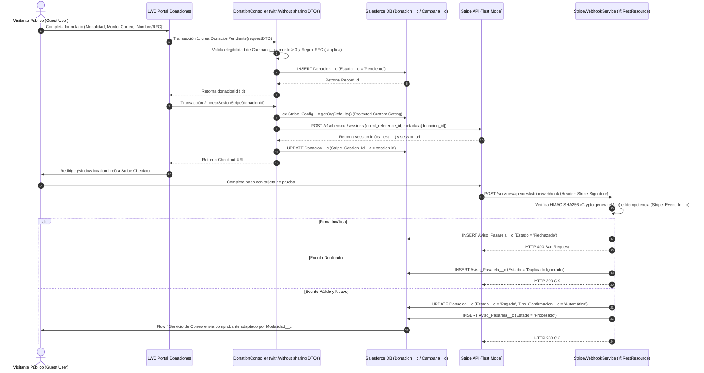

# Arquitectura Técnica y Decisiones de Diseño (ADR) — SF Vibe Lab

> **Propósito:** Documentar la arquitectura del sistema, el modelo de datos, el flujo de integración con Stripe y el cumplimiento estricto de los mínimos **M1**, **M2** y **M3**.

## 1. Diagrama de Flujo de Integración (Patrón de Dos Transacciones + Webhook)

## 2. Decisiones Arquitectónicas Clave (ADRs)

### ADR-01: Stripe Checkout Sessions (Server-Side) en lugar de Stripe Elements
- **Contexto:** Lightning Web Security (LWS) y Content Security Policy (CSP) en Experience Cloud restringen iframes de terceros. Además, el mínimo **M3** prohíbe llaves en código o repositorio.
- **Decisión:** Utilizar `POST https://api.stripe.com/v1/checkout/sessions` desde Apex mediante el patrón de dos transacciones (`crearDonacionPendiente` seguido de `crearSesionStripe`).
- **Consecuencia:** Cero exposición de llaves en el cliente, cumplimiento total de M3 y prevención del error `System.CalloutException: You have uncommitted work pending`.

### ADR-02: Aislamiento de Seguridad para Guest User (Mínimo M2)
- **Contexto:** Los visitantes públicos no autenticados necesitan ver el progreso de las campañas y el muro de reconocimiento de donantes sin tener acceso directo de lectura al objeto `Donacion__c`.
- **Decisión:** El perfil Guest User no tiene permisos CRUD sobre `Donacion__c`. El controlador Apex expone únicamente clases Wrapper/DTO (`@AuraEnabled`) con los campos estrictamente públicos (`Nombre_Donante__c` y `Monto__c` solo cuando `Estado__c == 'Pagada'` y `Modalidad__c != 'Anónima'`).
- **Consecuencia:** Imposibilidad de extraer correos electrónicos, RFCs o registros de otros donantes desde la consola del navegador o APIs estándar.

### ADR-03: Almacenamiento Protegido de Secretos (Mínimo M3)
- **Contexto:** El repositorio de GitHub es público y cualquier llave en código o historial de Git causa pérdida directa de puntos.
- **Decisión:** Crear `Stripe_Config__c` como **Hierarchy Custom Setting** con visibilidad `Protected`. Los valores se cargan manualmente en Setup UI de la Org y se leen vía `Stripe_Config__c.getOrgDefaults()`.
