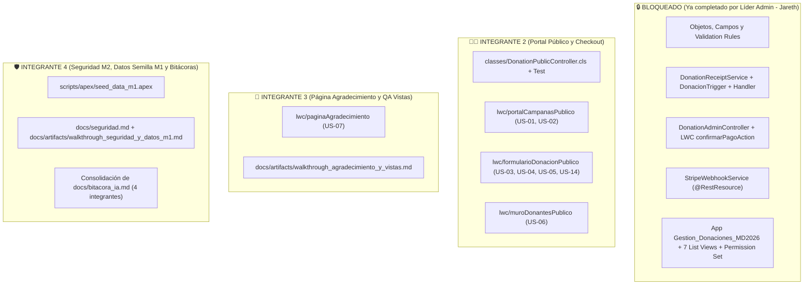

# Guía de Ejecución y Prompts para los Agentes de IA del Equipo (Integrantes 2, 3 y 4)

> [!IMPORTANT]
> **Estado Base del Repositorio:**
> Toda la infraestructura de base de datos (`Campana__c`, `Donacion__c`, `Aviso_Pasarela__c`, `Stripe_Config__c`), reglas de validación, aplicación administrativa (`Gestion_Donaciones_MD2026`), vistas de lista (`US-09` a `US-13`), confirmación manual (`DonationAdminController`, `confirmarPagoAction` — `US-12`), motor de comprobantes (`DonationReceiptService`, `DonacionTrigger` — `US-08`) y webhook de Stripe (`StripeWebhookService` — `US-13`, `US-16`, `US-17`) **ya están construidos, desplegados y probados al 100%**.
>
> Ningún integrante debe modificar ni sobrescribir esos archivos. Cada integrante debe copiar y pegar en su IDE (Antigravity / Cursor / Claude Code) exclusivamente el prompt de su sección.

---

## Mapa de Fronteras del Repositorio (Qué Tocar y Qué NO Tocar)



---

## 1. Instrucciones para el Integrante 2 (Líder de Portal Público y Stripe Checkout)

- **Historias asignadas:** `US-01`, `US-02`, `US-03`, `US-04`, `US-05`, `US-06`, `US-14`.
- **Rama sugerida:** `feat/public-portal-checkout`
- **Archivos que DEBE crear:**
  - `force-app/main/default/classes/DonationPublicController.cls` y `DonationPublicControllerTest.cls` (usando `HttpCalloutMock` para Stripe).
  - `force-app/main/default/lwc/portalCampanasPublico/` (`US-01`, `US-02` y contenedor de `US-03`–`US-06`).
  - `force-app/main/default/lwc/muroDonantesPublico/` (`US-06`).
  - `docs/artifacts/walkthrough_portal_publico.md`.

### Prompt Listo para Copiar y Pegar (Integrante 2)

```markdown
Lee primero `GEMINI.md`, `docs/arquitectura_y_decisiones.md` y `docs/artifacts/plan_implementacion_admin.md`.
Soy el **Integrante 2 (Líder de Portal Público)** y me corresponde implementar únicamente las historias **US-01, US-02, US-03, US-04, US-05, US-06 y US-14**.

⚠️ REGLAS ESTRICTAS DE FRONTERA Y SEGURIDAD:
1. NO modifiques ningún objeto (`Campana__c`, `Donacion__c`, `Aviso_Pasarela__c`, `Stripe_Config__c`), ni `DonationReceiptService`, `DonacionTrigger`, `DonationAdminController` o `StripeWebhookService`. El trigger `DonacionTrigger` y el webhook ya existen y se encargan automáticamente de marcar como Pagada y enviar los correos.
2. Cumple estrictamente **M2 (Guest User Least Privilege)**: NUNCA devuelvas SObjects `Donacion__c` ni `Campana__c` crudos al LWC. Usa clases Wrapper/DTO `@AuraEnabled` en `DonationPublicController` (`without sharing` controlado exclusivamente mediante DTOs que solo expongan campos públicos).
3. Cumple estrictamente **M3 (Cero Secretos)**: NUNCA escribas llaves de Stripe (`sk_*`, `pk_*`, `whsec*`) en código. Lee `Stripe_Config__c.getOrgDefaults()` en el servidor.
4. Cuando despliegues subagentes (`software-builder`, `test-engineer`, `code-auditor`), usa OBLIGATORIAMENTE el **Modelo FLASH**.

### Contratos Técnicos que debes implementar:

1. **Clase Apex `DonationPublicController.cls` y `DonationPublicControllerTest.cls`:**
   - `@AuraEnabled(cacheable=true) public static List<CampanaPublicaDTO> obtenerCampanasActivas()`:
     - Consulta `Campana__c WHERE Activa__c = true ORDER BY Fecha_Fin__c ASC NULLS LAST, Name ASC`.
     - Calcula en el DTO si la campaña acepta donaciones (`elegibleParaDonar`): `Activa__c == true` Y `(Fecha_Fin__c == null || Fecha_Fin__c >= Date.today())` Y `(Permitir_Sobrecupo__c == true || Monto_Recaudado__c < Meta__c)` (`US-01 AC4/AC5`).
   - `@AuraEnabled(cacheable=true) public static List<DonanteReconocimientoDTO> obtenerMuroDonantes(Id campanaId)`:
     - Consulta `Donacion__c WHERE Campana__c = :campanaId AND Estado__c = 'Pagada' AND Modalidad__c IN ('Con crédito', 'Con factura') ORDER BY CreatedDate DESC LIMIT 50`.
     - Retorna **SOLO** `nombreDonante` (`Nombre_Donante__c`), `monto` (`Monto__c`) y `fecha` (`CreatedDate`). **PROHIBIDO incluir `Correo__c`, `RFC__c` o donaciones `'Anónima'`** (`US-06`, `M2`).
   - **Patrón de Dos Transacciones para Stripe Checkout (`US-02` a `US-05`, `US-14`):**
     - **Transacción 1 (DML):** `@AuraEnabled public static Id crearDonacionPendiente(SolicitudDonacionDTO input)`
       - Valida que la campaña esté activa, no haya vencido (`Fecha_Fin__c >= TODAY()`) y no esté llena sin sobrecupo.
       - Valida `monto > 0`, `correo` válido y reglas de `modalidad`:
         - `'Anónima'`: fuerza `Nombre_Donante__c = null` y `RFC__c = null`.
         - `'Con crédito'`: exige `Nombre_Donante__c` no vacío y fuerza `RFC__c = null`.
         - `'Con factura'`: exige `Nombre_Donante__c` y valida `RFC__c` (normalizado con `trim().toUpperCase()`) contra el Regex oficial del SAT: `^[A-Z&Ñ]{3,4}[0-9]{2}(0[1-9]|1[0-2])(0[1-9]|[12][0-9]|3[01])[A-Z0-9]{3}$`.
       - Inserta `Donacion__c` con `Estado__c = 'Pendiente'` y retorna el `Id`.
     - **Transacción 2 (Callout + DML):** `@AuraEnabled public static String crearSesionStripe(Id donacionId)`
       - Lee `Stripe_Config__c.getOrgDefaults()` (`Secret_Key__c`, `Success_URL__c`, `Cancel_URL__c`).
       - Realiza `HttpRequest` `POST https://api.stripe.com/v1/checkout/sessions` (`application/x-www-form-urlencoded`) enviando:
         - `mode=payment`
         - `client_reference_id=` + `donacion.Id`
         - `metadata[donacion_id]=` + `donacion.Id`
         - `customer_email=` + `EncodingUtil.urlEncode(donacion.Correo__c, 'UTF-8')`
         - `line_items[0][price_data][currency]=mxn`
         - `line_items[0][price_data][unit_amount]=` + `String.valueOf((donacion.Monto__c * 100).longValue())`
         - `line_items[0][price_data][product_data][name]=` + `EncodingUtil.urlEncode('Donación: ' + donacion.Campana__r.Name, 'UTF-8')`
         - `line_items[0][quantity]=1`
         - `success_url` y `cancel_url`
       - Parsea la respuesta de Stripe, actualiza `Donacion__c.Stripe_Session_Id__c = sessionId` y retorna la `url` de Checkout para redirigir con `window.location.href`.
   - Implementa `DonationPublicControllerTest.cls` con `HttpCalloutMock` cubriendo todos los casos positivos y negativos (>90% cobertura).

2. **Componentes LWC Públicos (`ExperienceBundle` / `lightningCommunity__Page`):**
   - Construye los componentes LWC para listar campañas con barra de progreso, mostrar el muro público de donantes y el formulario interactivo con montos sugeridos ($100, $250, $500, $1,000 MXN o libre), selector de las 3 modalidades y validación de RFC en vivo.
   - Documenta todo en `docs/artifacts/walkthrough_portal_publico.md` y agrega tu fila en `docs/bitacora_ia.md`.
```

---

## 2. Instrucciones para el Integrante 3 (UI de Agradecimiento y Evidencias de Vistas)

- **Historias asignadas:** `US-07` (desarrollo LWC estático) y validación funcional con capturas de `US-10` y `US-11`.
- **Rama sugerida:** `feat/thank-you-page-and-views-qa`
- **Archivos que DEBE crear:**
  - `force-app/main/default/lwc/paginaAgradecimiento/` (`paginaAgradecimiento.html`, `.js`, `.css`, `.js-meta.xml`).
  - `docs/artifacts/walkthrough_agradecimiento_y_vistas.md`.

### Prompt Listo para Copiar y Pegar (Integrante 3)

```markdown
Lee primero `GEMINI.md` y `docs/artifacts/walkthrough_capa_declarativa_admin.md`.
Soy el **Integrante 3** y mi alcance es seguro y acotado:
1. Implementar el componente LWC `paginaAgradecimiento` para la ruta `/agradecimiento` de Experience Cloud (**US-07**).
2. Generar la guía y plantilla de evidencias funcionales de las List Views ya creadas para **US-10** (`Todas_las_Donaciones`) y **US-11** (`Solicitudes_de_Factura`).

⚠️ REGLAS ESTRICTAS:
- El componente `paginaAgradecimiento` NO debe hacer consultas SOQL ni exponer datos personales de ningún donante en la URL ni en pantalla (**M2**: protege el anonimato si la donación fue `Anónima`).
- Debe estar expuesto para Experience Cloud (`lightningCommunity__Page`, `lightningCommunity__Default`).
- Debe mostrar una confirmación visual clara de que su pago fue recibido por la pasarela, que su comprobante ha sido enviado por correo electrónico según la modalidad elegida, un resumen de impacto para los estudiantes de Mexico Dreamin 2026 y un botón para volver al listado de campañas (`/`).
- Documenta el componente y el checklist de capturas de `US-10` y `US-11` en `docs/artifacts/walkthrough_agradecimiento_y_vistas.md` y agrega tu fila correspondiente en `docs/bitacora_ia.md`.
```

---

## 3. Instrucciones para el Integrante 4 (Auditoría Guest User, Datos Semilla M1 y Bitácoras)

- **Historias asignadas:** `US-15` (Verificación de Seguridad de Guest User en segundo nivel), script de datos semilla ficticios (`M1`) y consolidación de [`docs/bitacora_ia.md`](file:///c:/Users/Jaret/Documents/salesforce/Donations/docs/bitacora_ia.md) (`C3`) y [`docs/preguntas_y_reportes.md`](file:///c:/Users/Jaret/Documents/salesforce/Donations/docs/preguntas_y_reportes.md) (`C7`).
- **Rama sugerida:** `docs/security-verification-and-seed-data`
- **Archivos que DEBE crear/actualizar:**
  - `scripts/apex/seed_data_m1.apex`
  - `docs/seguridad.md` y `docs/artifacts/walkthrough_seguridad_y_datos_m1.md`
  - Actualización de [`docs/plan_pruebas_y_seguridad.md`](file:///c:/Users/Jaret/Documents/salesforce/Donations/docs/plan_pruebas_y_seguridad.md) y [`docs/bitacora_ia.md`](file:///c:/Users/Jaret/Documents/salesforce/Donations/docs/bitacora_ia.md).

### Prompt Listo para Copiar y Pegar (Integrante 4)

```markdown
Lee primero `GEMINI.md`, `docs/plan_pruebas_y_seguridad.md` y `docs/artifacts/reporte_auditoria_calidad_seguridad.md`.
Soy el **Integrante 4 (Responsable de Evidencias de Seguridad M2, Datos Semilla M1 y Trazabilidad C3/C7)**.

⚠️ REGLAS ESTRICTAS:
1. Cumple **M1 (100% Datos Ficticios)**: Todos los nombres, campañas, correos (`@test-md2026.org`) y RFCs (`XAXX010101000`, `GODE561231GR8`, `EKU9003173C9`) deben ser 100% ficticios.
2. NO modifiques las clases Apex ni los objetos existentes.

### Tareas a ejecutar:
1. **Script de Datos Semilla (`scripts/apex/seed_data_m1.apex`):**
   - Crea un script Anonymous Apex idempotente que inserte 4 campañas de prueba para Mexico Dreamin 2026:
     - 1 campaña activa con sobrecupo permitido (`Permitir_Sobrecupo__c = true`).
     - 1 campaña activa sin sobrecupo que esté cerca o al 100% de su meta (`Permitir_Sobrecupo__c = false`).
     - 1 campaña cuya `Fecha_Fin__c` ya venció (ayer) para demostrar el bloqueo por fecha (`US-01 AC5`).
     - 1 campaña inactiva (`Activa__c = false`) para demostrar que no aparece en el portal público (`US-09 AC2`).
   - Inserta donaciones ficticias en las 3 modalidades (`Anónima`, `Con crédito`, `Con factura`) y en estados `Pagada` y `Pendiente`.
2. **Documentación de Seguridad para `US-15` (`docs/seguridad.md` y `docs/artifacts/walkthrough_seguridad_y_datos_m1.md`):**
   - Documenta los permisos de perfiles/Permission Sets, el aislamiento del Guest User Profile (0 permisos CRUD sobre `Donacion__c`), los comandos exactos de verificación en consola/DevTools y `curl` contra `/services/data/v67.0/sobjects/Donacion__c` y `/services/apexrest/stripe/webhook/` demostrando el rechazo de accesos no autorizados.
3. **Actualización de Bitácora (`docs/bitacora_ia.md`):**
   - Registra tu entrada detallada cumpliendo el Criterio C3.
```
