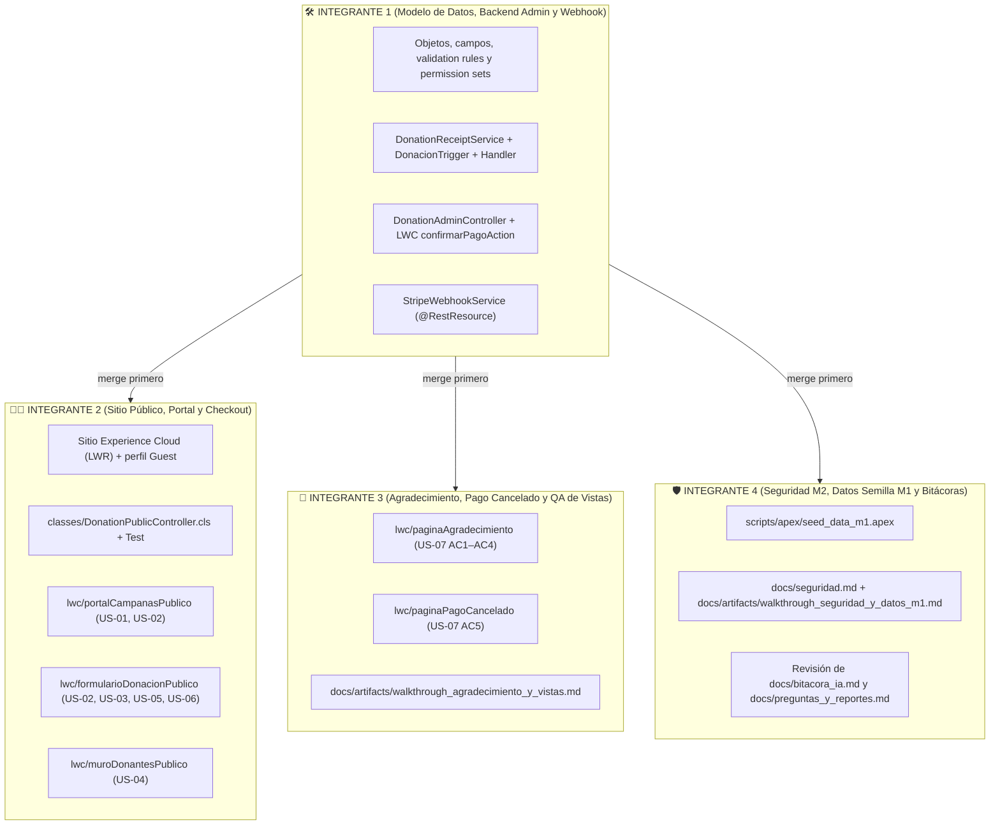

# Guía de Ejecución y Prompts para los Agentes de IA del Equipo (Integrantes 1, 2, 3 y 4)

> [!IMPORTANT]
> **Versión 2 (2026-11-08).** Los prompts se reescribieron para alinearlos con el backlog actualizado (issues US-01 a US-20 en GitHub Projects) y con los hallazgos de la auditoría del proyecto. La fuente de verdad de cada historia son **los criterios de aceptación del issue en GitHub**.
>
> **Reglas de los agentes:** `CLAUDE.md`, `GEMINI.md` y `.agents/rules/donation-portal.md` ya están alineados con este documento y con el backlog (versión 2). Si aun así encuentras una contradicción con un issue, prevalece el issue.

## Estado Base del Repositorio

- **Ya construido por el Integrante 1:** objetos (`Campana__c`, `Donacion__c`, `Aviso_Pasarela__c`, `Stripe_Config__c`), reglas de validación, app `Gestion_Donaciones_MD2026`, vistas de lista, confirmación manual (`DonationAdminController`, `confirmarPagoAction`), comprobantes (`DonationReceiptService`, `DonacionTrigger`) y webhook (`StripeWebhookService`).
- **Requiere correcciones antes de seguir:** la auditoría encontró riesgos en el código existente (el webhook acepta cualquier evento firmado, el comprobante se marca como enviado aunque falle el correo, etc.) y el backlog agregó campos nuevos. Por eso el **Integrante 1 ejecuta primero su prompt de correcciones** (sección 0).
- **Orden de ejecución:**
  1. Integrante 1 (correcciones y modelo de datos) → merge a `main`.
  2. Integrantes 2, 3 y 4 en paralelo, cada uno en su rama, partiendo del `main` actualizado.
- **Regla de fronteras:** solo el Integrante 1 modifica objetos, campos, reglas de validación, permission sets y las clases existentes. Si otro integrante necesita un cambio de modelo, lo pide al Integrante 1 (issue o mensaje), no lo hace en su rama.
- **Historias de Entrega 2 sin prompt todavía:** `US-18` (campañas anteriores), `US-19` (moderación) y `US-20` (factura simulada, condicional). Tendrán prompt cuando se planee esa entrega. Los prompts de esta versión ya dejan preparados los campos que necesitan.

---

## Mapa de Fronteras del Repositorio (Qué Tocar y Qué NO Tocar)



## Reglas Comunes para Todos los Prompts

- **M1:** solo datos ficticios y Stripe en modo de prueba. Los correos de prueba usan el dominio reservado `@example.com`; para comprobar que un correo llega, usa un buzón del equipo **solo en la org**, nunca en el repo.
- **M2:** el usuario invitado nunca recibe SObjects crudos ni el Id de una donación; solo DTOs con campos públicos.
- **M3:** ninguna llave (`sk_*`, `pk_*`, `rk_*`, `whsec_*`), token, URL de login ni usuario de la org en código, documentos o commits. Las llaves viven solo en `Stripe_Config__c` dentro de la org.
- **Nunca pegues llaves, tokens ni datos personales en el chat de la IA.**
- **C3:** al terminar, cada integrante agrega su fila en `docs/bitacora_ia.md`, indicando explícitamente si la IA cometió un error, cómo se detectó y cómo se corrigió.
- **C6:** pruebas `@isTest` con más del 90% de cobertura en las clases nuevas y `sf code-analyzer run` sin hallazgos críticos; cada supresión lleva su justificación en un comentario.
- Si usas subagentes en Antigravity (`software-builder`, `test-engineer`, `code-auditor`), usa el **Modelo FLASH**.

---

## 0. Instrucciones para el Integrante 1 (Correcciones al Código Existente y Modelo de Datos)

- **Historias relacionadas:** `US-01`, `US-04`, `US-05`, `US-06`, `US-08`, `US-09`, `US-12`, `US-13`, `US-16`, `US-17` (y campos preparados para `US-18` a `US-20`).
- **Rama sugerida:** `fix/model-and-backend-corrections`
- **Archivos que modifica:** `force-app/main/default/objects/**`, `permissionsets/**`, `StripeWebhookService`, `DonationReceiptService`, `DonacionTriggerHandler`, `DonationAdminController` y sus pruebas.

### Prompt Listo para Copiar y Pegar (Integrante 1)

```markdown
Lee primero `CLAUDE.md` (o `GEMINI.md`), `docs/arquitectura_y_decisiones.md`, `docs/artifacts/guia_ejecucion_integrantes_2_3_4.md` (sección "Reglas Comunes") y los issues US-01, US-04, US-05, US-06, US-08, US-09, US-12, US-13, US-16 y US-17 del repositorio en GitHub. Si algo contradice un issue, prevalece el issue.
Soy el **Integrante 1 (Líder Admin y Backend)**. Debo corregir el código que ya construimos y agregar los campos nuevos del backlog, sin implementar el portal público (eso es del Integrante 2).

⚠️ REGLAS: M1, M2 y M3 de la guía. No escribas llaves ni usuarios de la org. No borres pruebas existentes; actualízalas.

### Parte A: Modelo de datos
1. `Campana__c`:
   - `Fecha_Inicio__c` (Date, requerido) y `Fecha_Fin__c` pasa a requerido.
   - `Proposito__c` (Long Text, requerido) e `Imagen_URL__c` (URL).
   - `Vigente__c` (fórmula Checkbox): `Activa__c` Y `Fecha_Inicio__c <= TODAY()` Y `Fecha_Fin__c >= TODAY()`.
   - Validation rule `Fecha_Fin_Posterior_A_Inicio`: `Fecha_Fin__c < Fecha_Inicio__c` → error.
   - Validation rule `Meta_Bloqueada_Si_Vigente`: `ISCHANGED(Meta__c) && Fecha_Inicio__c <= TODAY()` → error "No se puede cambiar la meta de una campaña que ya inició" (US-09 AC4).
2. `Donacion__c`:
   - `Nombre_Publico__c` (Text 80): nombre que se muestra en el muro (US-04 AC4).
   - `Visible_En_Reconocimiento__c` (Checkbox, default true): para moderación (US-04 AC6, US-19).
   - `Tipo_Persona__c` (fórmula Text): RFC de 12 caracteres → "Moral"; de 13 → "Física"; vacío si no hay RFC (US-05 AC6).
   - `Referencia_Publica__c` (Text 36, Unique, External ID): referencia opaca (UUID) que se envía a Stripe y al navegador en lugar del Id (US-06 AC5).
   - `Fecha_Pago__c` (DateTime): se llena al pasar a Pagada; el comprobante usa esta fecha.
   - `Error_Comprobante__c` (Text 255): motivo si el correo no se pudo enviar (US-08 AC5).
   - Validation rule `Monto_Minimo`: `Monto__c < 10` → error "El monto mínimo es $10.00 MXN" (US-02 AC3).
   - Validation rule `Pagada_Requiere_Tipo_Confirmacion`: Estado `Pagada` sin `Tipo_Confirmacion__c` → error (US-12 AC5). La acción manual pone `Manual` y el webhook pone `Automática` en la misma operación.
   - Validation rule `Tipo_Confirmacion_Inmutable`: `ISCHANGED(Tipo_Confirmacion__c) && NOT(ISBLANK(PRIORVALUE(Tipo_Confirmacion__c)))` → error (US-13 AC4).
   - Actualiza `RFC_Valido_En_Modalidad_Factura` para normalizar mayúsculas si aplica; la validación de fecha real del RFC se hace en Apex (Parte C).
3. `Aviso_Pasarela__c`:
   - `Tipo_Evento__c` (Text 100).
   - `Estado_Aviso__c`: agrega los valores `Error` e `Ignorado`.
4. Permission sets (US-13, US-19):
   - Conserva `Coordinacion_Tesoreria_Admin` como permiso de Tesorería (ya está asignado al equipo; no lo borres) y crea `Moderacion_Reconocimiento` (solo editar `Nombre_Publico__c` y `Visible_En_Reconocimiento__c`; lectura del resto).
   - En ambos, `Aviso_Pasarela__c` es solo lectura (sin Edit ni Delete) y `Tipo_Confirmacion__c` es de solo lectura.
5. NO agregues código postal, régimen fiscal ni uso de CFDI (pendiente de confirmar con el cliente, P3).

### Parte B: Webhook (`StripeWebhookService`) (US-16, US-17)
1. Busca la donación por `Referencia_Publica__c` (`client_reference_id` o `metadata[referencia]`), ya no por Id.
2. Tipos de evento:
   - `checkout.session.completed` con `payment_status = 'paid'`, o `checkout.session.async_payment_succeeded` → `Pagada`, `Tipo_Confirmacion__c = 'Automática'`, `Fecha_Pago__c = now`.
   - `checkout.session.expired` → `Expirada` (solo si sigue `Pendiente`).
   - Cualquier otro tipo → aviso `Ignorado`, sin cambiar donaciones.
3. Monto: si `amount_total` ≠ `Monto__c * 100` o `currency` ≠ `mxn`, no se marca Pagada y el aviso queda `Rechazado` con el motivo (US-16 AC4).
4. Firma: rechaza si el timestamp de `Stripe-Signature` tiene más de 5 minutos de diferencia (US-17 AC4).
5. Duplicados: solo un aviso previo `Procesado` con el mismo `Stripe_Event_Id__c` cuenta como duplicado; un reintento de un evento que antes fue `Rechazado` o `Error` se procesa normalmente (US-17 AC5).
6. Errores inesperados: usa `Database.setSavepoint()`/`rollback`, registra un aviso `Error` con el motivo, responde HTTP 500 para que Stripe reintente (US-16 AC5). Guarda siempre `Tipo_Evento__c`.

### Parte C: Comprobantes y RFC (US-05, US-08)
1. `DonationReceiptService`: revisa cada `Messaging.SendEmailResult`; solo marca `Comprobante_Enviado__c = true` si el envío fue exitoso; si falla, guarda el motivo en `Error_Comprobante__c` (US-08 AC5).
2. Texto del comprobante en español. Para `Con factura`: incluye nombre legal, RFC y la frase "Este comprobante no es un CFDI"; elimina la palabra "timbrado" (US-05 AC4).
3. Usa `Fecha_Pago__c` como fecha del comprobante.
4. Crea una clase utilitaria `RfcValidator` (pública, con pruebas) que normaliza con `trim().toUpperCase()`, aplica el patrón del SAT y comprueba que la fecha `AAMMDD` exista (rechaza 30 de febrero, mes 13, día 40; acepta 29 de febrero si el año es bisiesto en 19AA o 20AA). El Integrante 2 la reutilizará.

### Parte D: Pruebas y calidad
1. Actualiza las pruebas existentes y agrega casos para cada criterio nuevo (tipos de evento, expiración, monto distinto, timestamp viejo, reintento tras error, fallo de correo, regla de bloqueo de meta, RFC con fecha inexistente).
2. Los correos de prueba usan `@example.com`.
3. Ejecuta `sf apex run test` y `sf code-analyzer run`; justifica cada supresión (`without sharing` del webhook, etc.).
4. Documenta los cambios en `docs/artifacts/walkthrough_correcciones_modelo_y_backend.md` y agrega tu fila en `docs/bitacora_ia.md` indicando si la IA cometió errores y cómo se corrigieron.
```

---

## 1. Instrucciones para el Integrante 2 (Sitio Público, Portal y Stripe Checkout)

- **Historias asignadas:** `US-01`, `US-02`, `US-03`, `US-04`, `US-05`, `US-06`, `US-14`.
- **Requisito previo:** el PR del Integrante 1 ya está en `main`.
- **Rama sugerida:** `feat/public-portal-checkout`
- **Archivos que DEBE crear:**
  - Sitio Experience Cloud con plantilla **Build Your Own (LWR)**, recuperado al repo (`digitalExperiences/`, `digitalExperienceConfigs/`, `networks/`, `sites/`).
  - `force-app/main/default/classes/DonationPublicController.cls` y `DonationPublicControllerTest.cls` (usando `HttpCalloutMock` para Stripe).
  - `force-app/main/default/lwc/portalCampanasPublico/`, `formularioDonacionPublico/` y `muroDonantesPublico/`.
  - `docs/artifacts/walkthrough_portal_publico.md`.

### Prompt Listo para Copiar y Pegar (Integrante 2)

```markdown
Lee primero `CLAUDE.md` (o `GEMINI.md`), `docs/arquitectura_y_decisiones.md`, `docs/artifacts/guia_ejecucion_integrantes_2_3_4.md` (sección "Reglas Comunes") y los issues US-01, US-02, US-03, US-04, US-05, US-06 y US-14 del repositorio en GitHub. Si algo contradice un issue, prevalece el issue.
Soy el **Integrante 2 (Líder de Portal Público)** y me corresponde implementar únicamente las historias **US-01, US-02, US-03, US-04, US-05, US-06 y US-14**.

⚠️ REGLAS ESTRICTAS DE FRONTERA Y SEGURIDAD:
1. NO modifiques objetos, campos, reglas de validación, permission sets ni las clases existentes (`DonationReceiptService`, `DonacionTrigger`, `DonationAdminController`, `StripeWebhookService`). Si necesitas un cambio de modelo, detente y avísame para pedírselo al Integrante 1.
2. **M2:** NUNCA devuelvas SObjects `Donacion__c` ni `Campana__c` al LWC, y NINGÚN método público recibe ni devuelve el Id de una donación. Usa DTOs `@AuraEnabled` con solo campos públicos. `DonationPublicController` es `without sharing` únicamente porque el invitado no tiene permisos de objeto; justifícalo en un comentario y en el reporte de Code Analyzer.
3. **M3:** NUNCA escribas llaves de Stripe en código. Lee `Stripe_Config__c.getOrgDefaults()` en el servidor.

### Parte A: Sitio Experience Cloud (US-14)
1. Crea el sitio con la plantilla **Build Your Own (LWR)**, con acceso público para invitados ("Guest users can see and interact with the site without logging in").
2. Páginas: inicio `/` (campañas, formulario y muro), `/agradecimiento` y `/pago-cancelado` (vacías: los componentes los hace el Integrante 3). No agregues buscador global, perfiles ni pestañas internas.
3. Perfil del invitado: solo acceso a la clase `DonationPublicController`; **cero** permisos de objeto sobre `Donacion__c` y `Aviso_Pasarela__c`.
4. Publica y activa el sitio. Recuerda: en LWR cada cambio requiere volver a publicar.
5. En la org (no en el repo), configura `Stripe_Config__c.Success_URL__c = <URL del sitio>/agradecimiento` y `Cancel_URL__c = <URL del sitio>/pago-cancelado`.
6. Recupera el sitio al repo (`sf project retrieve start -m DigitalExperienceBundle DigitalExperienceConfig Network CustomSite`) y revisa que no incluya usuarios, correos ni llaves antes del commit.

### Parte B: Clase `DonationPublicController` y su prueba
1. `@AuraEnabled(cacheable=true) public static List<CampanaPublicaDTO> obtenerCampanasActivas()`:
   - Consulta `Campana__c` con `Activa__c = true AND Fecha_Inicio__c <= TODAY AND Fecha_Fin__c >= TODAY`, ordenadas por `Fecha_Fin__c ASC, Name ASC` (US-01 AC6).
   - DTO: `id`, `nombre`, `descripcion`, `proposito`, `imagenUrl`, `meta`, `recaudado`, `porcentaje`, `fechaFin`, `elegibleParaDonar` y `motivoCierre`.
   - `elegibleParaDonar = Permitir_Sobrecupo__c || Monto_Recaudado__c < Meta__c` (US-01 AC4/AC5); si no es elegible, `motivoCierre = 'Meta alcanzada'`.
2. `@AuraEnabled(cacheable=true) public static List<DonanteReconocimientoDTO> obtenerMuroDonantes(Id campanaId)`:
   - Consulta `Donacion__c` con `Campana__c = :campanaId AND Estado__c = 'Pagada' AND Modalidad__c IN ('Con crédito', 'Con factura') AND Visible_En_Reconocimiento__c = true`, ordenadas por `Fecha_Pago__c DESC`. Sin `LIMIT` de 50: el muro muestra a todos (US-04 AC5); si hace falta, pagina.
   - Retorna **SOLO** `nombrePublico` (`Nombre_Publico__c`, o `Nombre_Donante__c` si está vacío) y `monto`. **PROHIBIDO** incluir fecha, correo, RFC, nombre legal (cuando hay nombre público), Id de la donación o donaciones `'Anónima'` (US-04 AC2, M2).
3. `@AuraEnabled public static String iniciarDonacion(SolicitudDonacionDTO input)`. **Una sola transacción, primero el callout y después el DML** (sustituye a `crearDonacionPendiente` + `crearSesionStripe(Id)`):
   - Valida en el servidor (aunque el LWC ya valide):
     - la campaña es vigente y elegible;
     - `monto >= 10` con máximo 2 decimales, sin máximo propio (US-02 AC3/AC5);
     - el correo tiene formato válido y es obligatorio en todas las modalidades (US-03 AC6).
   - Reglas por modalidad:
     - `'Anónima'`: fuerza `Nombre_Donante__c`, `Nombre_Publico__c` y `RFC__c` a null (US-03).
     - `'Con crédito'`: exige `Nombre_Donante__c`; `Nombre_Publico__c` opcional (si viene vacío, se usa el nombre); fuerza `RFC__c = null` (US-04).
     - `'Con factura'`: exige nombre legal y RFC válido con `RfcValidator` (creado por el Integrante 1); `Solicita_Factura__c = true`; `Nombre_Publico__c` opcional (si viene vacío, se usa el nombre legal) (US-05, US-04 AC4).
   - Genera `referencia = UUID.randomUUID().toString()`.
   - `POST https://api.stripe.com/v1/checkout/sessions` (`application/x-www-form-urlencoded`) con:
     - `mode=payment`, `submit_type=donate`, `locale=es` (sin `payment_method_types`: Stripe ya no lo acepta; los métodos de pago se activan en el Dashboard);
     - `client_reference_id=<referencia>` y `metadata[referencia]=<referencia>` (nunca el Id);
     - `customer_email=<correo codificado>`;
     - `line_items[0][price_data][currency]=mxn`, `line_items[0][price_data][unit_amount]=<monto * 100 como Long>`, `line_items[0][price_data][product_data][name]=<'Donación: ' + nombre de la campaña, codificado>`, `line_items[0][quantity]=1`;
     - `expires_at=<ahora + 3600 segundos>` (US-06 AC4);
     - `success_url` y `cancel_url` desde `Stripe_Config__c`.
   - Si Stripe responde con error, lanza `AuraHandledException` con un mensaje genérico y no insertes nada.
   - Si responde bien, inserta `Donacion__c` con `Estado__c = 'Pendiente'`, `Referencia_Publica__c = referencia` y `Stripe_Session_Id__c = session.id`, y retorna **solo** la `url` de Checkout (US-06 AC1, AC2 y AC5).
4. `DonationPublicControllerTest` con `HttpCalloutMock` cubre positivos y negativos de cada criterio. Incluye:
   - monto 9.99 rechazado;
   - RFC con fecha inexistente;
   - campaña futura o vencida;
   - error de Stripe sin registro insertado;
   - el DTO del muro sin correo ni RFC;
   - cobertura mayor al 90%.

### Parte C: Componentes LWC públicos (`lightningCommunity__Page`, `lightningCommunity__Default`)
1. `portalCampanasPublico` (US-01, US-02):
   - Lista de campañas con imagen, descripción, propósito, fecha límite y barra de progreso (US-01 AC7).
   - Si solo hay una campaña vigente, abre su detalle directamente (US-01 AC8).
   - Una campaña llena sin sobrecupo muestra "Cerrada para nuevas donaciones" y no permite donar (US-01 AC5).
2. `formularioDonacionPublico` (US-02, US-03, US-05, US-06):
   - Montos sugeridos $100, $250, $500, $1,000, $2,000, $5,000, $10,000 y $20,000 MXN, más un campo de monto libre (US-01 AC3).
   - Validación en vivo: mínimo $10.00, máximo 2 decimales y sin máximo propio.
   - Si el monto es de $1,000 o más, muestra un diálogo de confirmación con el monto exacto antes de redirigir (US-02 AC4).
   - Selector de las 3 modalidades. Al cambiar a `Anónima`, limpia nombre, nombre público y RFC (US-03 AC5).
   - Validación de RFC en vivo, en mayúsculas.
   - Al enviar, llama a `iniciarDonacion` y redirige con `window.location.href = url`.
3. `muroDonantesPublico` (US-04): lista con desplazamiento automático que se pausa al pasar el mouse; solo nombre público y monto.
4. Textos en español. No guardes datos del donante en `localStorage` ni en la URL.

### Parte D: Evidencia y bitácora
- Documenta en `docs/artifacts/walkthrough_portal_publico.md` la URL del sitio (sin usuarios ni llaves), las páginas, los permisos del invitado y cómo probar cada criterio.
- Agrega tu fila en `docs/bitacora_ia.md` indicando si la IA cometió errores y cómo se corrigieron.
```

---

## 2. Instrucciones para el Integrante 3 (Agradecimiento, Pago Cancelado y Evidencias de Vistas)

- **Historias asignadas:** `US-07` (páginas estáticas), más la guía de evidencias funcionales de `US-10` y `US-11`.
- **Requisito previo:** el PR del Integrante 1 ya está en `main`. Las páginas `/agradecimiento` y `/pago-cancelado` las crea el Integrante 2 en el sitio; tú haces los componentes y los colocas cuando el sitio exista.
- **Rama sugerida:** `feat/thank-you-page-and-views-qa`
- **Archivos que DEBE crear:**
  - `force-app/main/default/lwc/paginaAgradecimiento/` (`.html`, `.js`, `.css`, `.js-meta.xml`).
  - `force-app/main/default/lwc/paginaPagoCancelado/` (`.html`, `.js`, `.css`, `.js-meta.xml`).
  - `docs/artifacts/walkthrough_agradecimiento_y_vistas.md`.

### Prompt Listo para Copiar y Pegar (Integrante 3)

```markdown
Lee primero `CLAUDE.md` (o `GEMINI.md`), `docs/artifacts/guia_ejecucion_integrantes_2_3_4.md` (sección "Reglas Comunes"), `docs/artifacts/walkthrough_capa_declarativa_admin.md` y los issues US-07, US-10 y US-11 del repositorio en GitHub.
Soy el **Integrante 3** y mi alcance es acotado:
1. Implementar el componente LWC `paginaAgradecimiento` para la ruta `/agradecimiento` del sitio (US-07 AC1–AC4).
2. Implementar el componente LWC `paginaPagoCancelado` para la ruta `/pago-cancelado` (US-07 AC5).
3. Generar la guía y plantilla de evidencias funcionales de las List Views ya creadas para US-10 (`Todas_las_Donaciones`) y US-11 (`Solicitudes_de_Factura`).

⚠️ REGLAS ESTRICTAS:
- Ninguno de los dos componentes hace llamadas a Apex ni SOQL, y no lee ni muestra parámetros de la URL (`session_id`, Ids, correos). Así no se expone ningún dato aunque alguien manipule la URL (US-07 AC3/AC4, M2).
- Ambos se exponen para Experience Cloud LWR (`lightningCommunity__Page`, `lightningCommunity__Default`).
- `paginaAgradecimiento` muestra exactamente la idea "Recibimos tu donación; te enviaremos tu comprobante por correo cuando se confirme el pago". **Nunca** afirma que el pago ya está confirmado ni que el comprobante ya se envió (RF-D4 CA2). Incluye un resumen del impacto del programa Mexico Dreamin 2026 y un botón para volver a las campañas (`/`).
- `paginaPagoCancelado` dice claramente que **no se realizó ningún cargo**, que la donación no se registró como pagada y cómo intentarlo de nuevo, con un botón para volver a las campañas (`/`).
- Textos en español y diseño responsivo (se ve bien en celular).
- No modifiques objetos, clases existentes ni la configuración del sitio; si algo falta, avísame para pedirlo al Integrante 1 o 2.
- Documenta los componentes y el checklist de capturas de US-10 y US-11 en `docs/artifacts/walkthrough_agradecimiento_y_vistas.md`. La vista de US-11 muestra `Solicita_Factura__c` y `Tipo_Persona__c`.
- Agrega tu fila en `docs/bitacora_ia.md` indicando si la IA cometió errores y cómo se corrigieron.
```

---

## 3. Instrucciones para el Integrante 4 (Auditoría Guest User, Datos Semilla M1 y Bitácoras)

- **Historias asignadas:**
  - `US-15` (verificación de seguridad del usuario invitado; Entrega 1).
  - Script de datos semilla ficticios (`M1`).
  - Revisión de que todos los integrantes tengan sus entradas en [`docs/bitacora_ia.md`](../bitacora_ia.md) (`C3`) y [`docs/preguntas_y_reportes.md`](../preguntas_y_reportes.md) (`C7`).
- **Requisito previo:** el PR del Integrante 1 ya está en `main`. Para las pruebas de US-15 en la org, el sitio y `DonationPublicController` del Integrante 2 deben estar desplegados.
- **Rama sugerida:** `docs/security-verification-and-seed-data`
- **Archivos que DEBE crear/actualizar:**
  - `scripts/apex/seed_data_m1.apex`
  - `docs/seguridad.md` y `docs/artifacts/walkthrough_seguridad_y_datos_m1.md`
  - [`docs/plan_pruebas_y_seguridad.md`](../plan_pruebas_y_seguridad.md) y [`docs/bitacora_ia.md`](../bitacora_ia.md).

### Prompt Listo para Copiar y Pegar (Integrante 4)

```markdown
Lee primero `CLAUDE.md` (o `GEMINI.md`), `docs/artifacts/guia_ejecucion_integrantes_2_3_4.md` (sección "Reglas Comunes"), `docs/plan_pruebas_y_seguridad.md`, `docs/artifacts/reporte_auditoria_calidad_seguridad.md` y los issues US-01, US-09 y US-15 del repositorio en GitHub.
Soy el **Integrante 4 (Responsable de Evidencias de Seguridad M2, Datos Semilla M1 y Trazabilidad C3/C7)**.

⚠️ REGLAS ESTRICTAS:
1. **M1 (100% datos ficticios):**
   - Nombres y campañas inventados.
   - Correos solo con el dominio reservado `@example.com` (nadie los recibe; no uses dominios que podrían existir).
   - RFCs de prueba: `XAXX010101000`, `GODE561231GR8`, `EKU9003173C9`.
2. NO modifiques las clases Apex, los objetos ni los permission sets; si algo falla, documéntalo y avísame para pedírselo al Integrante 1 o 2.
3. No incluyas usuarios de la org, URLs de login, Ids de org ni llaves en ningún documento.

### Tareas a ejecutar:
1. **Script de datos semilla (`scripts/apex/seed_data_m1.apex`)**, Anonymous Apex idempotente (si ya existen, no duplica), con campañas de Mexico Dreamin 2026 que tengan fecha de inicio, fecha de fin, descripción, propósito e imagen:
   - 1 vigente con sobrecupo permitido (`Permitir_Sobrecupo__c = true`) que ya supere su meta (US-01 AC4).
   - 1 vigente sin sobrecupo al 100% de su meta (US-01 AC5).
   - 1 vigente normal con avance parcial.
   - 1 con `Fecha_Fin__c` de ayer (US-01 AC5; servirá para US-18 en Entrega 2).
   - 1 con `Fecha_Inicio__c` futura (US-01 AC6: no debe aparecer).
   - 1 inactiva (`Activa__c = false`), que no debe aparecer en el portal.
   - Donaciones en las 3 modalidades (`Anónima`, `Con crédito`, `Con factura`) y en estados `Pagada`, `Pendiente` y `Expirada`.
   - Las `Pagada` llevan `Tipo_Confirmacion__c`, `Fecha_Pago__c` y `Comprobante_Enviado__c = true`, para que el trigger no envíe correos.
   - Incluye al menos un nombre público distinto del nombre legal y una donación con `Visible_En_Reconocimiento__c = false`.
2. **`docs/seguridad.md`** con estas 6 secciones:
   1. Pasos reproducibles de la prueba del invitado. Debe poder repetirlos alguien externo al equipo (US-15 AC3):
      - en la interfaz, en una ventana de incógnito;
      - en DevTools, con la respuesta de red del muro;
      - `curl` sin sesión contra `/services/data/vXX.X/sobjects/Donacion__c`;
      - una llamada Aura/Apex manipulada a los métodos de `DonationPublicController` con otra referencia o datos ajenos (US-15 AC4/AC5).
   2. Tabla de permisos del perfil invitado, con la justificación de cada uno.
   3. Dónde viven las llaves (`Stripe_Config__c` protegido) y el protocolo si se filtra una: rotar la llave en Stripe, actualizar `Stripe_Config__c` y revisar el historial.
   4. Clasificación de datos personales: correo, nombre legal, RFC, nombre público y datos de pago (estos viven solo en Stripe).
   5. Riesgos conocidos y su mitigación.
   6. Sección "Entrega 2: webhook" vacía, para documentar después el endpoint y su usuario.
3. **`docs/artifacts/walkthrough_seguridad_y_datos_m1.md`**: cómo ejecutar el script y el resultado esperado en el portal.
4. **`docs/plan_pruebas_y_seguridad.md`**: agrega casos de prueba para los criterios nuevos:
   - mínimo $10 y confirmación desde $1,000;
   - expiración y cancelación;
   - muro sin fecha y con moderación;
   - referencia opaca;
   - RFC con fecha inexistente;
   - tipos de evento y monto distinto en el webhook;
   - fallo de correo.
5. **Bitácoras:** agrega tu fila en `docs/bitacora_ia.md` (C3) indicando si la IA cometió errores. Revisa que los 4 integrantes tengan filas y entradas propias en `docs/preguntas_y_reportes.md` (C7: al menos 4 por integrante, en al menos 2 semanas distintas); si alguien no tiene, avísale. No las escribas por otros.
```
