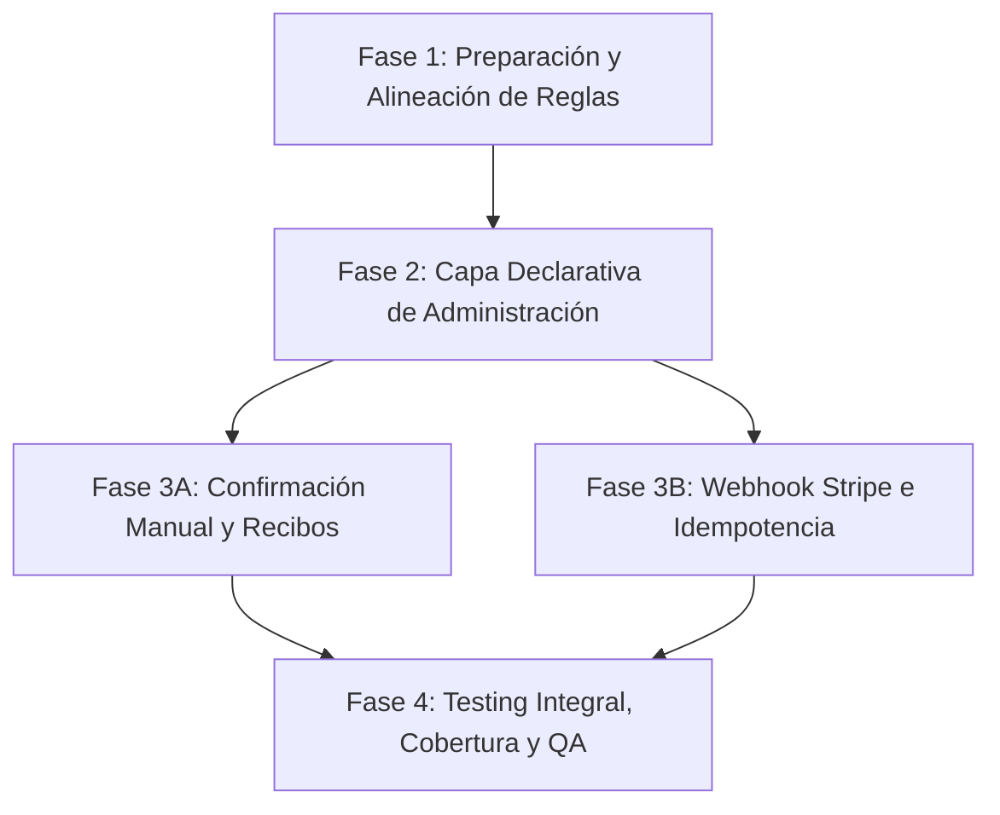

# Plan de Implementación Integral: Capa Declarativa, Administración, Confirmación de Pagos, Recibos y Webhook Stripe

**Proyecto:** Portal de Donaciones Mexico Dreamin 2026 — SF Vibe Lab  
**Versión:** 1.0.0  
**Fecha:** 2026-11-06  
**Alcance de Historias de Usuario:** `US-08`, `US-09`, `US-10`, `US-11`, `US-12`, `US-13`, `US-16`, `US-17`  
**Equipo Asignado:** 4 integrantes de UADY

---

## 1. Diagnóstico e Impacto Arquitectónico

### 1.1 Contexto Actual
El repositorio cuenta con la definición base de objetos personalizados (`Campana__c`, `Donacion__c`, `Aviso_Pasarela__c` y el Custom Setting jerárquico protegido `Stripe_Config__c`), así como las reglas de validación fundamentales. Sin embargo, carece de la capa de interfaz administrativa para Salesforce Lightning (Tabs, Layouts, List Views, Aplicación y Conjunto de Permisos), el motor de emisión de comprobantes personalizados, la acción rápida de confirmación manual para Tesorería, el recálculo automático de montos recaudados y el endpoint Apex REST para la recepción y verificación criptográfica de webhooks de Stripe.

### 1.2 Mínimos Críticos de Arquitectura y Seguridad
- **M1 (100% Modo Prueba):** Pruebas en Sandbox / Developer Edition Org y Stripe Test Mode.
- **M2 (Menor Privilegio en Guest User):** Las clases del portal público no exponen SObjects crudos; sin embargo, en esta capa administrativa (`DonationAdminController`, `DonacionTriggerHandler`, `DonationReceiptService` y `StripeWebhookService`), el acceso se otorga vía Permission Set para usuarios internos y contexto seguro `without sharing` controlado para el endpoint REST de Stripe.
- **M3 (Zero Secrets en Código o Git):** Las credenciales de Stripe (`Secret_Key__c`, `Webhook_Secret__c`) se obtienen exclusivamente en tiempo de ejecución desde `Stripe_Config__c.getOrgDefaults()`.
- **C6 (Estándares de Codificación Apex):** Sin SOQL/DML dentro de bucles, queries bulkificadas, excepciones tipadas con `AuraHandledException` y cobertura unitaria >= 85% con mocks HTTP.

---

## 2. Asignación del Equipo de 4 Integrantes

| Rol | Integrante | Responsabilidades Principales |
|---|---|---|
| **Tech Lead / Integration Architect** | Integrante 1 (Jareth Moo) | Arquitectura de integración Stripe, verificación HMAC-SHA256, diseño de endpoints Apex REST, revisión de PRs y control de secretos. |
| **Backend & Automation Developer** | Integrante 2 | Implementación de `DonationReceiptService`, `DonacionTriggerHandler`, `DonacionTrigger`, recálculo de recaudación y controlador `DonationAdminController`. |
| **Frontend & Declarative Specialist** | Integrante 3 | Construcción de metadatos SFDX: Custom Tabs, Page Layouts, Lightning App, List Views, Permission Set y componente LWC `confirmarPagoAction`. |
| **QA & Security Compliance Engineer** | Integrante 4 | Casos de prueba unitarios (`*Test.cls`), mocks HTTP, validación contra SAT Regex, pruebas de idempotencia de webhook y matriz de trazabilidad. |

---

## 3. Contratos Técnicos por Historia de Usuario

### 3.1 `US-08` — Generación y Envío Automatizado de Comprobantes por Modalidad
- **Componente:** `DonationReceiptService.cls`
- **Contrato:**
  ```apex
  public without sharing class DonationReceiptService {
      public static void enviarComprobantes(Set<Id> donacionIds);
      @TestVisible private static String construirCuerpoCorreo(Donacion__c donacion);
      @TestVisible private static String construirAsuntoCorreo(Donacion__c donacion);
  }
  ```
- **Reglas por Modalidad:**
  - `Anónima`: Folio (`Name`), Campaña (`Campana__r.Name`), Fecha y Monto. Agradecimiento genérico. **CERO exposición de nombre o RFC.**
  - `Con crédito`: Nombre del Donante, Folio, Campaña, Fecha, Monto y confirmación explícita de crédito público en el muro de donantes.
  - `Con factura`: Razón Social / Nombre, RFC, Folio, Campaña, Fecha, Monto y notificación expresa de que la solicitud fue turnada a Tesorería.
- **Idempotencia:** Solo procesa registros con `Estado__c = 'Pagada'` y `Comprobante_Enviado__c = false`. Tras el envío exitoso, actualiza `Comprobante_Enviado__c = true`.

### 3.2 `US-09` — Gestión y Visibilidad de Campañas (Declarativo)
- **Componentes:**
  - `tabs/Campana__c.tab-meta.xml`: Tab personalizado con icono `Custom41: Stack of Cash`.
  - `layouts/Campana__c-Campaña Layout.layout-meta.xml`: Detalle de campos y lista relacionada `Donaciones__r`.
  - `objects/Campana__c/listViews/Campanas_Activas.listView-meta.xml`: Filtro `Activa__c = true`.
  - `objects/Campana__c/listViews/Todas_las_Campanas.listView-meta.xml`: Visibilidad completa.

### 3.3 `US-10` — Registro Centralizado de Donaciones y Auditoría (Declarativo)
- **Componentes:**
  - `tabs/Donacion__c.tab-meta.xml`: Tab personalizado con icono `Custom17: Sack`.
  - `layouts/Donacion__c-Donación Layout.layout-meta.xml`: Secciones organizadas (General, Donante/Facturación, Pasarela de Pago) y lista relacionada `Avisos_Pasarela__r`.
  - `objects/Donacion__c/listViews/Todas_las_Donaciones.listView-meta.xml`: Vista general de donaciones.

### 3.4 `US-11` — Monitoreo y Filtrado de Solicitudes de Facturación (Declarativo)
- **Componente:**
  - `objects/Donacion__c/listViews/Solicitudes_de_Factura.listView-meta.xml`: Filtro `Solicita_Factura__c = true` mostrando Folio, Campaña, Nombre/Razón Social, RFC, Correo, Monto, Estado y Fecha de Creación.

### 3.5 `US-12` — Confirmación Manual de Pagos y Notificación (Acción Rápida LWC)
- **Componentes:**
  - `classes/DonationAdminController.cls`:
    ```apex
    public with sharing class DonationAdminController {
        @AuraEnabled(cacheable=true)
        public static ResumenConfirmacionDTO obtenerResumenDonacion(Id donacionId);
        
        @AuraEnabled
        public static ResultadoConfirmacionDTO confirmarPagoManual(Id donacionId);
    }
    ```
  - `lwc/confirmarPagoAction`: Modal interactivo que consume `DonationAdminController` con confirmación, validación de estado previo y cierre seguro.
  - `objects/Donacion__c/quickActions/Confirmar_Pago_Manual.quickAction-meta.xml`
  - `flexipages/Donacion_Record_Page.flexipage-meta.xml`
  - `objects/Donacion__c/listViews/Donaciones_Pendientes.listView-meta.xml`: Filtro `Estado__c = 'Pendiente'`.

### 3.6 `US-13` — Registro de Auditoría de Avisos de Pasarela (Declarativo)
- **Componentes:**
  - `tabs/Aviso_Pasarela__c.tab-meta.xml`: Tab personalizado con icono `Custom67: Gears`.
  - `layouts/Aviso_Pasarela__c-Aviso de Pasarela Layout.layout-meta.xml`
  - `objects/Aviso_Pasarela__c/listViews/Avisos_Rechazados.listView-meta.xml`: Filtro `Estado_Aviso__c = 'Rechazado'`.
  - `objects/Aviso_Pasarela__c/listViews/Todos_los_Avisos.listView-meta.xml`: Auditoría integral.

### 3.7 `US-16` — Conciliación Automática de Donaciones vía Webhook
- **Componente:** `StripeWebhookService.cls`
- **Flujo:** Parseo de evento `checkout.session.completed`, resolución de donación por `client_reference_id` o `metadata[donacion_id]`, cambio de estado a `Pagada`, asignación de `Tipo_Confirmacion__c = 'Automática'`, disparo de trigger y registro de `Aviso_Pasarela__c` con `Estado_Aviso__c = 'Procesado'`.

### 3.8 `US-17` — Seguridad Criptográfica e Idempotencia de Webhooks
- **Componente:** `StripeWebhookService.cls`
- **Verificación HMAC-SHA256:** Extracción de `t` y `v1` de `Stripe-Signature`, cálculo con `Crypto.generateMac` contra `Webhook_Secret__c` de `Stripe_Config__c`.
- **Rechazo Inmediato:** Si la firma es inválida, se registra `Aviso_Pasarela__c` con `Estado_Aviso__c = 'Rechazado'`, `Motivo_Rechazo__c = 'Firma criptográfica HMAC-SHA256 inválida o ausente'` y se retorna HTTP `400`.
- **Idempotencia:** Si el evento `evt_...` ya fue procesado, se registra `Aviso_Pasarela__c` con `Estado_Aviso__c = 'Duplicado Ignorado'` utilizando un sufijo de unicidad (`_DUP_`) para preservar el External ID sin violar constraints, y se retorna HTTP `200` sin modificar la donación.

---

## 4. Fases de Ejecución



1. **Fase 1:** Sincronización de reglas a 4 integrantes y creación del repositorio de artefactos `docs/artifacts/`.
2. **Fase 2:** Despliegue de metadatos declarativos (Tabs, Layouts, App, List Views, Permission Set).
3. **Fase 3A:** Construcción de `DonationReceiptService`, `DonacionTrigger`, `DonacionTriggerHandler`, `DonationAdminController` y LWC `confirmarPagoAction`.
4. **Fase 3B:** Construcción de `StripeWebhookService` con validación criptográfica y auditoría.
5. **Fase 4:** Construcción de clases de prueba unitarias con cobertura >= 85%, validación de casos negativos y actualización de bitácoras.

---

## 5. Matriz de Riesgos y Mitigación

| Riesgo Técnico | Impacto | Estrategia de Mitigación |
|---|---|---|
| Colisión de clave única `Stripe_Event_Id__c` al registrar reintentos de webhook | Alto (Falla de DML no controlada) | En eventos duplicados, registrar con sufijo `_DUP_<timestamp>` manteniendo el folio original en el motivo de rechazo y lookup a la donación. |
| Exposición de secretos en metadatos o commits de Git (M3) | Crítico (-10 pts, descalificación) | Uso estricto de `Stripe_Config__c` jerárquico protegido y validación con `git diff --stat` previo a cada commit. |
| Fuga de datos de donantes anónimos en correos (M2 / RF-D5) | Crítico | Validación estricta en `construirCuerpoCorreo`: si es `Anónima`, bajo ninguna circunstancia se imprime nombre ni RFC. |
| Desincronización del monto recaudado en campañas | Medio | Lógica centralizada en `DonacionTriggerHandler.recalcularMontoRecaudadoCampanas` ejecutada en cada cambio de estado hacia o desde `'Pagada'`. |

---

## 6. Matriz de Despacho de Subagentes

| Orden | Subagente | Alcance de Tareas | Modelo Recomendado |
|---|---|---|---|
| **Orden 1** | `software-builder` (Instancia Actual) | Pasos 1, 2 y 3: Reglas de 4 integrantes, Metadatos declarativos, Triggers/Handlers, Controladores, LWC y Webhook REST. | Flash / Sonnet |
| **Orden 2** | `qa-tester` (Siguiente Etapa) | Paso 4: Creación de `*Test.cls`, Mocks HTTP, Cobertura unitaria >= 85%, Verificación de Casos Negativos y Criterios DoD. | Flash / Sonnet |
