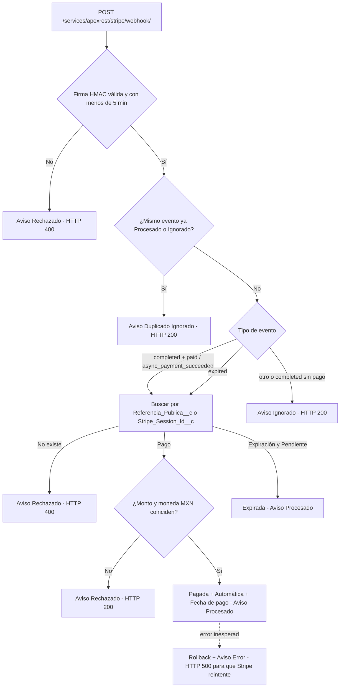

# Walkthrough: Correcciones al Modelo de Datos y al Backend (Integrante 1)

**Fecha:** 2026-11-08
**Origen:** prompt de la sección 0 de [`guia_ejecucion_integrantes_2_3_4.md`](./guia_ejecucion_integrantes_2_3_4.md) y hallazgos de la auditoría del proyecto.
**Historias:** `US-01`, `US-02`, `US-04`, `US-05`, `US-06`, `US-08`, `US-09`, `US-12`, `US-13`, `US-16`, `US-17` (y campos preparados para `US-18` a `US-20`).
**Estado:** desplegado en la sandbox del equipo; 55 pruebas pasando.

---

## 1. Modelo de datos

### Campaña (`Campana__c`)

| Elemento | Tipo | Para qué | Historia |
|---|---|---|---|
| `Fecha_Inicio__c` | Fecha | La campaña aparece y acepta donaciones a partir de esta fecha | US-01 AC6 |
| `Proposito__c` | Texto largo | Para qué se usará el dinero | US-01 AC7 |
| `Imagen_URL__c` | URL | Imagen de la campaña (pendiente P13: archivo o URL) | US-01 AC7 |
| `Vigente__c` | Fórmula | Activa y hoy entre fecha de inicio y fecha fin | US-01 AC6 |
| `Campos_Obligatorios_Campana` | Regla | Exige fecha de inicio, fecha fin y propósito | US-09 AC1 |
| `Fecha_Fin_Posterior_A_Inicio` | Regla | La fecha fin no puede ser anterior a la de inicio | US-09 AC3 |
| `Meta_Bloqueada_Si_Vigente` | Regla | No se puede cambiar la meta cuando la campaña ya inició (pendiente P2) | US-09 AC4 |

Las fechas y el propósito se exigen con una regla de validación (no con "requerido" a nivel de campo) para no romper registros que ya existían y para mostrar un mensaje claro en español.

### Donación (`Donacion__c`)

| Elemento | Tipo | Para qué | Historia |
|---|---|---|---|
| `Nombre_Publico__c` | Texto 80 | Nombre que aparece en el muro; si está vacío se usa el nombre del donante | US-04 AC4 |
| `Visible_En_Reconocimiento__c` | Casilla (true) | Moderación: ocultar del muro sin afectar el avance | US-04 AC6, US-19 |
| `Tipo_Persona__c` | Fórmula | Moral (RFC de 12) o Física (RFC de 13) | US-05 AC6 |
| `Referencia_Publica__c` | Texto 36, único | UUID opaco que se envía a Stripe y al navegador en lugar del Id | US-06 AC5 |
| `Fecha_Pago__c` | Fecha/hora | Cuándo pasó a Pagada; la usa el comprobante | US-08 |
| `Error_Comprobante__c` | Texto 255 | Motivo si el correo no se pudo enviar | US-08 AC5 |
| `Monto_Minimo_MXN` | Regla | Monto mínimo de $10.00 MXN (sustituye a `Monto_Mayor_A_Cero`, pendiente P6) | US-02 AC3 |
| `Pagada_Requiere_Tipo_Confirmacion` | Regla | Solo puede estar Pagada con tipo de confirmación | US-12 AC5 |
| `Tipo_Confirmacion_Inmutable` | Regla | El tipo de confirmación no cambia una vez asignado | US-13 AC4 |
| `Anonima_Sin_Nombre_Ni_RFC` | Regla (actualizada) | Ahora también impide nombre público en donaciones anónimas | US-03 |

### Aviso de Pasarela (`Aviso_Pasarela__c`)

- Nuevo campo `Tipo_Evento__c`.
- Nuevos valores de `Estado_Aviso__c`: `Ignorado` y `Error`.

### Permisos

| Permission set | Qué puede hacer |
|---|---|
| `Coordinacion_Tesoreria_Admin` (se conservó el nombre porque ya estaba asignado al equipo) | Crear y editar campañas y donaciones, y confirmar pagos. **Ya no puede borrar** campañas, donaciones ni avisos. Avisos de pasarela, tipo de confirmación, comprobante enviado, referencia y sesión de Stripe son **solo lectura**. |
| `Moderacion_Reconocimiento` (nuevo) | Leer campañas y donaciones, y editar solo el nombre público y la visibilidad en el muro. **No ve el RFC.** |

> **Límite conocido:** los campos requeridos (`Monto__c`, `Estado__c`, `Modalidad__c`, `Correo__c`) no admiten permisos por campo en Salesforce, así que cualquier usuario con edición de Donación puede modificarlos. Restringirlos para moderación queda para US-19 (Entrega 2). Los usuarios con perfil de administrador ignoran estos permisos; para demostrar US-12 AC5 y US-13 AC4 hay que usar un usuario sin perfil de administrador.

Los layouts de Campaña, Donación y Aviso muestran los campos nuevos. En Donación y Aviso, los campos de control aparecen como solo lectura. La vista *Solicitudes de Factura* agrega `Tipo_Persona__c` y las vistas de avisos agregan `Tipo_Evento__c`.

---

## 2. Trigger de Donación (`DonacionTrigger` + `DonacionTriggerHandler`)

Ahora corre en `before insert`, `before update` y `after update`:

1. **Referencia pública:** si no viene, se genera un UUID; una vez asignada no se puede cambiar.
2. **RFC:** se guarda sin espacios y en mayúsculas, y se rechaza si la fecha `AAMMDD` no existe (por ejemplo, 30 de febrero). La estructura la sigue validando la regla `RFC_Valido_En_Modalidad_Factura`.
3. **Fecha de pago:** se llena al pasar a Pagada (o al insertar ya Pagada).
4. **Comprobante:** al pasar a Pagada se envía una sola vez por transacción.

Se eliminó el recálculo manual del monto recaudado: era código que nunca se ejecutaba, porque `Monto_Recaudado__c` es un roll-up nativo.

La validación del RFC vive en la clase reutilizable `RfcValidator` (`normalizar`, `tieneFormato`, `esValido`), que también usará el portal público.

---

## 3. Comprobantes (`DonationReceiptService`)

- Revisa el resultado de cada correo. Solo marca `Comprobante_Enviado__c = true` si se envió; si falla, guarda el motivo en `Error_Comprobante__c` **sin revertir el pago**.
- El comprobante usa la fecha de pago (zona horaria de Ciudad de México).
- Modalidad con factura: dice "Este comprobante no es un CFDI y no tiene validez fiscal" y ya no menciona "timbrado".
- Con crédito y con factura: menciona el nombre público con el que aparecerá en el muro.

> **Hallazgo al desplegar:** en la sandbox del equipo la entregabilidad de correo está desactivada (`The organization is not permitted to send email`). Con el código anterior todas las donaciones se habrían marcado como "comprobante enviado" sin que saliera ningún correo. Para que lleguen los comprobantes, alguien con permisos de administrador debe ir a **Configuración → Entregabilidad** y elegir **Todos los correos electrónicos**.

---

## 4. Webhook (`StripeWebhookService`)

- La donación se busca por **referencia pública** (`client_reference_id` o `metadata[referencia]`) y, si no hay, por Id de sesión. **Nunca por el Id del registro.**
- El registro se bloquea (`FOR UPDATE`) para evitar dos confirmaciones simultáneas.
- Solo cuenta como duplicado un evento ya `Procesado` o `Ignorado`; un evento que antes fue `Rechazado` o terminó en `Error` se procesa normalmente si llega válido (US-17 AC5).
- Un monto o moneda distintos responden 200 (el evento es auténtico; reintentarlo no cambia nada), pero la donación no se marca Pagada.

---

## 5. Pruebas

| Clase de prueba | Qué cubre |
|---|---|
| `StripeWebhookServiceTest` (21) | Pago completado y asíncrono, búsqueda por sesión, completado sin pago, expiración, eventos no usados, monto y moneda distintos, firma inválida, alterada, ausente y antigua, duplicados, reintento tras rechazo, donación ya pagada, no encontrada, error inesperado con rollback, payload no JSON |
| `DonationReceiptServiceTest` (9) | Comprobante por modalidad, aviso de no CFDI, idempotencia, 200 registros, fallo de envío, envío real con estado consistente |
| `DonationAdminControllerTest` (5) | Confirmación manual y sus bloqueos |
| `ModeloDonacionesTest` (15) | Reglas de campaña y donación, referencia pública, RFC normalizado y con fecha inexistente, tipo de persona, fecha de pago |
| `RfcValidatorTest` (5) | RFC válidos, normalización, fechas inexistentes, años bisiestos, estructuras inválidas |

`DonacionTestFactory` crea campañas y donaciones de prueba con todos los campos obligatorios y correos `@example.com`.

Como la org no puede enviar correos, las pruebas que verifican el contenido del comprobante simulan un envío exitoso (`DonationReceiptService.simulacionEnvio`, que solo funciona dentro de pruebas). La prueba `testEnvioRealDejaEstadoConsistente` usa el envío real.

**Resultado del deploy:** 84 componentes, 55 de 55 pruebas pasando.

| Clase | Cobertura |
|---|---|
| `RfcValidator` | 100% |
| `DonacionTrigger` | 100% |
| `DonationAdminController` | 100% |
| `DonacionTriggerHandler` | 97.9% |
| `DonationReceiptService` | 97.0% |
| `StripeWebhookService` | 92.0% |

> **Code Analyzer:** no se pudo ejecutar en esta máquina porque sus motores de Apex requieren Java 11 o superior (solo hay Java 8). Queda pendiente correr `sf code-analyzer run` en un equipo con Java 11+.

---

## 6. Pendientes fuera del código

1. **Entregabilidad de correo** en la sandbox: Configuración → Entregabilidad → *Todos los correos electrónicos*.
2. **Completar la campaña existente:** "Mexico Dreamin 2026 Students Support" no tiene `Fecha_Inicio__c` ni `Proposito__c`, así que `Vigente__c` es falso y el portal no la mostrará. Al editarla, Salesforce pedirá esos datos.
3. **Code Analyzer** con Java 11+.
