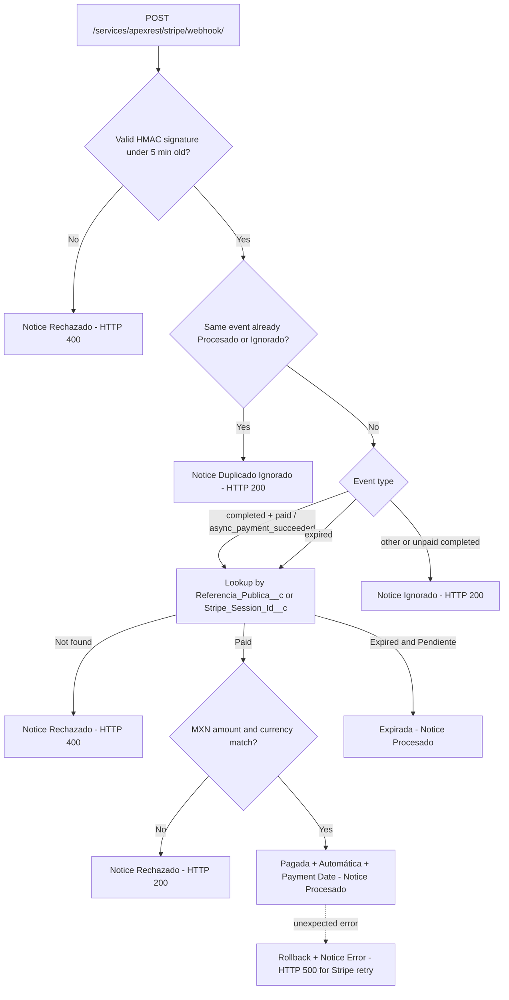

# Walkthrough: Data Model & Backend Corrections (Member 1)

**Date:** 2026-11-08  
**Origin:** Section 0 prompt from the team execution guide v2 and project audit findings.  
**Stories:** `US-01`, `US-02`, `US-04`, `US-05`, `US-06`, `US-08`, `US-09`, `US-12`, `US-13`, `US-16`, `US-17` (plus fields prepared for `US-18` to `US-20`).  
**Status:** Deployed to the team sandbox; 55 tests passing.

---

## 1. Data Model

### Campaign (`Campana__c`)

| Element | Type | Purpose | Story |
|---|---|---|---|
| `Fecha_Inicio__c` | Date | Campaign appears and accepts donations starting on this date | US-01 AC6 |
| `Proposito__c` | Long Text | Explains how funds will be used | US-01 AC7 |
| `Imagen_URL__c` | URL | Campaign image (pending P13: file upload vs. URL) | US-01 AC7 |
| `Vigente__c` | Formula | Active and today is between start date and end date | US-01 AC6 |
| `Campos_Obligatorios_Campana` | Validation Rule | Requires start date, end date, and purpose | US-09 AC1 |
| `Fecha_Fin_Posterior_A_Inicio` | Validation Rule | End date cannot precede start date | US-09 AC3 |
| `Meta_Bloqueada_Si_Vigente` | Validation Rule | Goal cannot be changed once the campaign has started (pending P2) | US-09 AC4 |

Dates and purpose are enforced via a validation rule (rather than field-level `required`) so existing records are not broken and users receive a clear Spanish error message.

### Donation (`Donacion__c`)

| Element | Type | Purpose | Story |
|---|---|---|---|
| `Nombre_Publico__c` | Text 80 | Name displayed on the recognition wall; falls back to donor name if blank | US-04 AC4 |
| `Visible_En_Reconocimiento__c` | Checkbox (`true`) | Moderation: hide from wall without affecting progress | US-04 AC6, US-19 |
| `Tipo_Persona__c` | Formula | `Moral` (12-char RFC) or `Física` (13-char RFC) | US-05 AC6 |
| `Referencia_Publica__c` | Text 36, unique | Opaque UUID sent to Stripe and the browser instead of the Salesforce Id | US-06 AC5 |
| `Fecha_Pago__c` | DateTime | Timestamp when status became `Pagada`; used on the receipt | US-08 |
| `Error_Comprobante__c` | Text 255 | Failure reason if receipt email could not be sent | US-08 AC5 |
| `Monto_Minimo_MXN` | Validation Rule | Minimum amount of $10.00 MXN (replaces `Monto_Mayor_A_Cero`, pending P6) | US-02 AC3 |
| `Pagada_Requiere_Tipo_Confirmacion` | Validation Rule | Can only be `Pagada` when `Tipo_Confirmacion__c` is set | US-12 AC5 |
| `Tipo_Confirmacion_Inmutable` | Validation Rule | Confirmation type cannot change once assigned | US-13 AC4 |
| `Anonima_Sin_Nombre_Ni_RFC` | Validation Rule (updated) | Now also forbids `Nombre_Publico__c` on anonymous donations | US-03 |

### Gateway Notice (`Aviso_Pasarela__c`)

- New field `Tipo_Evento__c`.
- New `Estado_Aviso__c` picklist values: `Ignorado` and `Error`.

### Permissions

| Permission Set | Capabilities |
|---|---|
| `Coordinacion_Tesoreria_Admin` (name preserved because it was already assigned to the team) | Create and edit campaigns and donations, and confirm payments. **Can no longer delete** campaigns, donations, or gateway notices. Gateway notices, confirmation type, receipt sent flag, public reference, and Stripe session Id are **read-only**. |
| `Moderacion_Reconocimiento` (new) | Read campaigns and donations, and edit only public name (`Nombre_Publico__c`) and wall visibility (`Visible_En_Reconocimiento__c`). **Cannot view RFC.** |

> **Known limitation:** Required fields (`Monto__c`, `Estado__c`, `Modalidad__c`, `Correo__c`) do not support field-level security restrictions in Salesforce, so any user with edit access to `Donacion__c` can modify them. Restricting them further for moderation is deferred to `US-19` (Delivery 2). System Administrator profiles bypass these restrictions; demonstrating `US-12 AC5` and `US-13 AC4` requires a non-admin user.

Campaign, Donation, and Gateway Notice page layouts expose the new fields. On Donation and Gateway Notice layouts, control fields are read-only. The *Solicitudes de Factura* list view adds `Tipo_Persona__c`, and the gateway notice list views add `Tipo_Evento__c`.

---

## 2. Donation Trigger (`DonacionTrigger` + `DonacionTriggerHandler`)

Now executes on `before insert`, `before update`, and `after update`:

1. **Public reference:** If blank, generates a UUID; once assigned, it cannot be changed.
2. **RFC:** Stored trimmed and uppercased, and rejected if the `YYMMDD` date does not exist (e.g., February 30). Format structure continues to be enforced by `RFC_Valido_En_Modalidad_Factura`.
3. **Payment date:** Populated when transitioning to `Pagada` (or inserted already `Pagada`).
4. **Receipt:** Sent once per transaction when transitioning to `Pagada`.

Manual recalculation of the collected amount was removed: that code never ran because `Monto_Recaudado__c` is a native Roll-Up Summary field.

RFC validation lives in the reusable `RfcValidator` class (`normalizar`, `tieneFormato`, `esValido`), which the public portal will also reuse.

---

## 3. Receipts (`DonationReceiptService`)

- Checks every `Messaging.SendEmailResult`. Sets `Comprobante_Enviado__c = true` only if sending succeeded; on failure, logs the reason in `Error_Comprobante__c` **without rolling back the payment**.
- The receipt uses `Fecha_Pago__c` (Mexico City time zone).
- `Con factura` modality: includes `"Este comprobante no es un CFDI y no tiene validez fiscal"` ("This receipt is not a CFDI and has no tax validity") and no longer mentions `"timbrado"`.
- `Con crédito` and `Con factura`: states the public name that will appear on the recognition wall.

> **Deployment finding:** Email deliverability is disabled in the team sandbox (`The organization is not permitted to send email`). With the previous code, all donations would have been marked as "receipt sent" even though no email left the org. For receipts to be delivered, an administrator must go to **Setup → Deliverability** and set Access Level to **All email**.

---

## 4. Webhook (`StripeWebhookService`)

- The donation is resolved by **public reference** (`client_reference_id` or `metadata[referencia]`), and if absent, by Session Id. **Never by Salesforce record Id.**
- The record is locked (`FOR UPDATE`) to prevent concurrent confirmations.
- Only an event already marked `Procesado` or `Ignorado` counts as duplicate; a retry of an event previously `Rechazado` or `Error` is processed normally if valid (`US-17 AC5`).
- Amount or currency mismatches return HTTP 200 (the event is authentic; retrying will not change it), while the donation is not marked `Pagada`.

---

## 5. Tests

| Test Class | Coverage Scope |
|---|---|
| `StripeWebhookServiceTest` (21) | Completed and async payments, session lookup, unpaid completion, expiration, unused events, amount and currency mismatches, invalid/tampered/missing/expired signatures, duplicates, retry after rejection, already-paid donation, not found, unexpected error with rollback, non-JSON payload |
| `DonationReceiptServiceTest` (9) | Receipts by modality, non-CFDI notice, idempotency, 200 bulk records, send failure, real send leaving consistent state |
| `DonationAdminControllerTest` (5) | Manual confirmation and validation blocks |
| `ModeloDonacionesTest` (15) | Campaign and donation rules, public reference, normalized RFC and nonexistent date, taxpayer type, payment date |
| `RfcValidatorTest` (5) | Valid RFCs, normalization, nonexistent dates, leap years, invalid formats |

`DonacionTestFactory` creates test campaigns and donations with all required fields and `@example.com` emails.

Because the org cannot send email when deliverability is off, tests verifying receipt body content simulate successful delivery (`DonationReceiptService.simulacionEnvio`, active only during tests). `testEnvioRealDejaEstadoConsistente` exercises the real send path.

**Deploy result:** 84 components, 55 of 55 tests passing.

| Class | Coverage |
|---|---|
| `RfcValidator` | 100% |
| `DonacionTrigger` | 100% |
| `DonationAdminController` | 100% |
| `DonacionTriggerHandler` | 97.9% |
| `DonationReceiptService` | 97.0% |
| `StripeWebhookService` | 92.0% |

> **Code Analyzer:** Could not run on that machine because its Apex engines require Java 11 or higher (only Java 8 was installed). Running `sf code-analyzer run` on a machine with Java 11+ remains pending.

---

## 6. Out-of-Code Pending Actions

1. **Email deliverability** in the sandbox: Setup → Deliverability → *All email*.
2. **Complete the existing campaign:** "Mexico Dreamin 2026 Students Support" lacks `Fecha_Inicio__c` and `Proposito__c`, so `Vigente__c` is false and the portal will not show it. Editing it will require those fields.
3. **Code Analyzer** on Java 11+.
