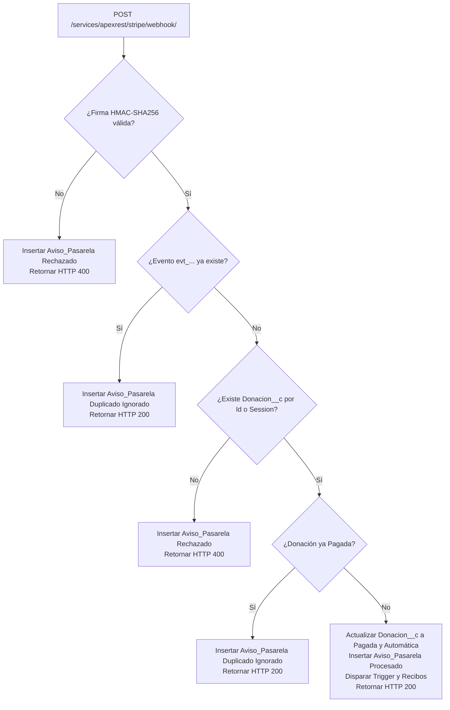

# Walkthrough: Arquitectura y Auditoría de Webhooks con Stripe (`US-13`, `US-16`, `US-17`)

**Proyecto:** Portal de Donaciones Mexico Dreamin 2026 — SF Vibe Lab  
**Fecha:** 2026-11-06  
**Autor:** Integrante 1 (Tech Lead / Integration Architect)  
**Alcance:** `StripeWebhookService.cls`, Verificación Criptográfica HMAC-SHA256, Idempotencia, Conciliación Automática y Auditoría en `Aviso_Pasarela__c`.

---

## 1. Diseño del Endpoint REST (`StripeWebhookService.cls`)

El servicio expone un endpoint REST de Salesforce en `@RestResource(urlMapping='/stripe/webhook/*')` que atiende peticiones `@HttpPost` públicas sin autenticación de usuario de Salesforce, pero con validación criptográfica estricta a nivel de payload y headers.

---

## 2. Verificación Criptográfica de la Firma (`US-17 AC1`, M3)

### 2.1 Cero Secretos en Código (M3)
El valor secreto del webhook (`Webhook_Secret__c`) se obtiene dinámicamente mediante `Stripe_Config__c.getOrgDefaults()`. Nunca se expone en código fuente ni se sube al control de versiones.

### 2.2 Algoritmo de Verificación HMAC-SHA256
1. Se extrae el encabezado `Stripe-Signature` (soporta minúsculas o mayúsculas mediante inspección insensible a mayúsculas).
2. Se extrae el timestamp `t` y la lista de firmas `v1`.
3. Se ensambla la carga firmada: `timestamp + '.' + rawBody`.
4. Se calcula el hash con `Crypto.generateMac('hmacSHA256', Blob.valueOf(cargaFirmada), Blob.valueOf(webhookSecret))`.
5. Se convierte el resumen a hexadecimal en minúsculas y se compara contra las firmas `v1` recibidas.
6. Si no coincide o falta algún dato, se inserta inmediatamente un registro de auditoría en `Aviso_Pasarela__c` con:
   - `Estado_Aviso__c = 'Rechazado'`
   - `Motivo_Rechazo__c = 'Firma criptográfica HMAC-SHA256 inválida o ausente'`
   - `res.statusCode = 400`
   - **Retorno limpio sin excepciones no controladas**, permitiendo que la transacción persista el registro de auditoría.

---

## 3. Idempotencia y Respeto a Constraints de Clave Única (`US-17 AC2`)

El campo `Aviso_Pasarela__c.Stripe_Event_Id__c` posee la restricción `<unique>true</unique>` a nivel de esquema de Salesforce.
- Si un evento con el mismo `eventId` (`evt_...`) ya fue procesado, no se puede reinsertar con el mismo valor sin causar un error de DML `DUPLICATE_VALUE`.
- **Estrategia Elegida:** El reintento duplicado se audita insertando un registro con `Stripe_Event_Id__c = eventId + '_DUP_' + Datetime.now().getTime()`, `Estado_Aviso__c = 'Duplicado Ignorado'`, lookup a la donación original y mensaje detallado con el ID original.
- Se responde con código HTTP `200` para que Stripe no continúe reintentando la entrega.
- No se vuelve a actualizar `Donacion__c` ni se genera un comprobante por segunda vez.

---

## 4. Conciliación Automática de Donaciones (`US-16 AC1`, `AC2`, `AC3`)

1. **Resolución de Donación:** Se extrae `client_reference_id`, `metadata.donacion_id` y `id` de la sesión de checkout (`cs_...`).
2. **Validación de Identificador:** Se comprueba si el valor corresponde a un ID de Salesforce de tipo `Donacion__c`. Si es válido, se consulta `Donacion__c`. Si no, se intenta localizar por `Stripe_Session_Id__c`.
3. **Donación No Encontrada (`AC3`):** Se inserta `Aviso_Pasarela__c` en estado `'Rechazado'`, con motivo explicativo y respuesta HTTP `400`.
4. **Donación ya Pagada (`AC2`):** Se inserta `Aviso_Pasarela__c` como `'Duplicado Ignorado'` con respuesta HTTP `200`.
5. **Transición a Pagada:**
   - `donacion.Estado__c = 'Pagada'`
   - `donacion.Tipo_Confirmacion__c = 'Automática'`
   - Si `Stripe_Session_Id__c` no estaba poblado, se asigna el ID de sesión.
   - `update donacion;` dispara `DonacionTrigger` -> `DonacionTriggerHandler` -> actualiza `Campana__c.Monto_Recaudado__c` y envía el correo de comprobante por `DonationReceiptService`.
   - Se inserta `Aviso_Pasarela__c` con `Estado_Aviso__c = 'Procesado'` y respuesta HTTP `200`.
