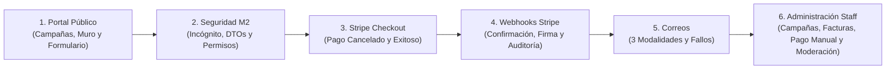

# Guía Completa y Guion para el Video de Funcionamiento — Mexico Dreamin 2026

> [!IMPORTANT]
> **Propósito de este documento:** Servir como lista de verificación (checklist) y guion paso a paso de **todo lo que debe mostrarse en el video de demostración funcional**, abarcando desde la experiencia pública del donante (Experience Cloud y Stripe Checkout) hasta el procesamiento de Webhooks, envío de correos y la operación administrativa del Staff (Coordinación, Tesorería y Moderación).

---

## 0. Reglas de Oro Antes de Grabar (Mínimos Críticos M1, M2 y M3)

> [!CAUTION]
> Violar cualquiera de estos 3 puntos durante la grabación puede invalidar historias o restar **10 puntos directos** en la evaluación.

1. **M1 — 100% Modo de Prueba y Datos Ficticios:**
   - En la pantalla de Stripe Checkout debe verse claramente el badge naranja/amarillo de **`MODO DE PRUEBA` / `TEST MODE`**.
   - Todos los datos mostrados en listados y formularios deben ser **ficticios** (nombres inventados, RFCs de prueba como `XAXX010101000`, `GODE561231GR8`, `EKU9003173C9`).
   - Los correos de los registros semilla deben usar `@example.com`. Si durante la grabación muestran la bandeja de entrada recibiendo los comprobantes, usen un **buzón controlado del equipo configurado solo para la prueba en vivo**, sin datos personales reales.
2. **M2 — Menor Privilegio del Usuario Invitado:**
   - El recorrido del portal público debe hacerse en una **ventana de incógnito** para demostrar que no hay sesión activa de Salesforce.
   - En ningún momento la URL ni la red deben mostrar un ID nativo de Salesforce (`a01...` / `a02...`) para una donación.
3. **M3 — Cero Secretos en Pantalla:**
   - **NUNCA** muestren en el video el valor de `Secret_Key__c` (`sk_test_...`) ni `Webhook_Secret__c` (`whsec_...`) dentro de `Stripe_Config__c` o en el Dashboard de Stripe sin enmascarar. Si muestran el Custom Setting `Stripe_Config__c`, muestren la estructura o los campos `Success_URL__c` / `Cancel_URL__c`, manteniendo ocultas las llaves.

---

## Mapa General del Recorrido del Video

---

## Bloque 1: Portal Web Público (`/md2026` en Ventana de Incógnito)

**Historias cubiertas:** `US-01`, `US-02`, `US-03`, `US-04`, `US-05`, `US-14`  
**Componentes involucrados:** [`portalCampanasPublico`](../force-app/main/default/lwc/portalCampanasPublico/portalCampanasPublico.js), [`formularioDonacionPublico`](../force-app/main/default/lwc/formularioDonacionPublico/formularioDonacionPublico.js), [`muroDonantesPublico`](../force-app/main/default/lwc/muroDonantesPublico/muroDonantesPublico.js), [`DonationPublicController.cls`](../force-app/main/default/classes/DonationPublicController.cls)

### 1.1 Experiencia del Sitio LWR y Limpieza de Interfaz (`US-14`)
- [ ] Abrir el sitio `/md2026` en una **ventana de incógnito** (demostrando acceso 100% público sin login).
- [ ] Mostrar que el sitio **no tiene** barra de búsqueda global de Salesforce, menú de perfil de usuario ni pestañas de objetos internos.
- [ ] Mostrar brevemente que el diseño es **responsivo** (ajustando el ancho de la ventana o con la vista móvil de DevTools).

### 1.2 Catálogo y Estados de Campañas (`US-01`)
- [ ] **Campañas vigentes (`Vigente__c = true`):** Mostrar las tarjetas de campaña ordenadas por fecha de fin (`Fecha_Fin__c`), evidenciando:
  - Imagen (`Imagen_URL__c`), título (`Name`), descripción (`Descripcion__c`), propósito (`Proposito__c`) y fecha límite (`Fecha_Fin__c`).
  - Barra de progreso con el monto recaudado (`Monto_Recaudado__c`), la meta (`Meta__c`) y el porcentaje de avance.
- [ ] **Campaña con sobrecupo permitido (`Permitir_Sobrecupo__c = true`):** Mostrar una campaña que ya superó el 100% de su meta pero **sigue permitiendo donar**.
- [ ] **Campaña cerrada por meta alcanzada (`Permitir_Sobrecupo__c = false`):** Mostrar una campaña al 100% sin sobrecupo que aparece como **"Cerrada para nuevas donaciones / Meta alcanzada"** con el botón de donar deshabilitado.
- [ ] **Filtro de vigencia:** Mencionar (y contrastar luego en la vista de Admin) que las campañas con fecha fin pasada (vencidas), fecha de inicio futura o inactivas (`Activa__c = false`) **no aparecen** en el portal público.

### 1.3 Muro de Reconocimiento de Donantes (`US-04`)
- [ ] Mostrar el componente `muroDonantesPublico` de una campaña:
  - Evidenciar el **desplazamiento automático (auto-scroll)** y cómo **se pausa al pasar el cursor encima (hover)**.
  - Destacar que únicamente muestra **Nombre Público** (o nombre del donante si no definió un alias público) y **Monto**.
  - Resaltar qué **NO** aparece: no hay donaciones `Anónima`, no hay donaciones `Pendiente` ni `Expirada`, no hay donaciones ocultadas por moderación (`Visible_En_Reconocimiento__c = false`), ni se muestra fecha, correo o RFC.

### 1.4 Formulario de Donación, Montos y las 3 Modalidades (`US-02`, `US-03`, `US-04`, `US-05`)
- [ ] **Selección de montos (`US-02`):**
  - Mostrar los 8 botones de montos sugeridos: **$100, $250, $500, $1,000, $2,000, $5,000, $10,000 y $20,000 MXN**.
  - Probar el campo de **monto libre**:
    - Ingresar un monto menor a $10 (ej. `9.50`) y mostrar el **error en vivo** (*"El monto mínimo es $10.00 MXN"*).
    - Ingresar más de 2 decimales y mostrar la validación.
  - Seleccionar un monto de **$1,000 MXN o más** (ej. $1,500) para mostrar que al intentar continuar aparece el **diálogo modal de confirmación** mostrando el monto exacto antes de redirigir a Stripe.
- [ ] **Las 3 Modalidades de Donación:**
  1. **Modalidad `Con crédito` (`US-04`):**
     - Mostrar que solicita **Nombre del donante** (obligatorio), **Nombre público** (opcional, para el muro) y **Correo electrónico** (obligatorio).
  2. **Modalidad `Con factura` (`US-05`):**
     - Mostrar que solicita **Nombre legal / Razón Social**, **RFC**, **Nombre público** (opcional) y **Correo electrónico**.
     - **Validación de RFC en vivo:**
       - Escribir en minúsculas y mostrar cómo se normaliza a mayúsculas.
       - Ingresar un RFC con fecha inexistente (ej. `GODE990230GR8` — 30 de febrero) y mostrar que el validador lo rechaza aunque cumpla el patrón de letras y números.
       - Ingresar un RFC válido de Persona Física (13 caracteres, ej. `GODE561231GR8`) o Persona Moral (12 caracteres, ej. `EKU9003173C9`).
  3. **Modalidad `Anónima` (`US-03`):**
     - **Prueba clave (`US-03 AC5`):** Estando en `Con factura` con Nombre, Nombre público y RFC escritos, cambiar el selector a **`Anónima`** y mostrar cómo el formulario **oculta y limpia automáticamente** esos campos, dejando únicamente el **Correo electrónico** (para enviar el recibo) y el monto.

---

## Bloque 2: Evidencia de Seguridad del Usuario Invitado (Mínimo M2 y `US-15`)

**Historias cubiertas:** `US-15`, `US-06 AC5`

- [ ] **Inspección de Red en DevTools (Ventana de Incógnito):**
  - Abrir las herramientas de desarrollador del navegador (`F12` → pestaña **Network / Red**) en el portal público.
  - Mostrar la respuesta JSON de `obtenerMuroDonantes`: evidenciar que cada elemento del arreglo contiene **únicamente** `nombrePublico` y `monto` (cero `Id`, cero `Correo__c`, cero `RFC__c`, cero `Nombre_Donante__c` legal cuando hay alias).
  - Mostrar que no se guarda ningún dato del donante en `localStorage` ni `sessionStorage`.
- [ ] **Permisos del Guest User Profile en Salesforce Setup:**
  - En la pestaña de administrador, mostrar el perfil **`Portal Donaciones MD2026 Perfil`**:
    - **Apex Class Access:** únicamente `DonationPublicController`.
    - **Object Permissions:** **cero permisos** (sin Read, Create, Edit ni Delete) sobre `Donacion__c`, `Campana__c` y `Aviso_Pasarela__c`.

---

## Bloque 3: Pasarela de Pago (Stripe Checkout) y Páginas de Retorno (`US-06`, `US-07`)

**Historias cubiertas:** `US-06`, `US-07`  
**Componentes involucrados:** [`paginaAgradecimiento`](../force-app/main/default/lwc/paginaAgradecimiento/paginaAgradecimiento.js), [`paginaPagoCancelado`](../force-app/main/default/lwc/paginaPagoCancelado/paginaPagoCancelado.js)

### 3.1 Escenario A: Pago Cancelado por el Usuario (`/pago-cancelado`)
1. [ ] Llenar el formulario público y dar clic en donar.
2. [ ] Mostrar la redirección a `checkout.stripe.com`:
   - Destacar que está en **español (`locale=es`)**, en **pesos mexicanos (`MXN`)**, con el concepto **`Donación: <Nombre de la Campaña>`** y el correo precargado.
3. [ ] Antes de pagar, mostrar en Salesforce (pestaña de Staff) que ya se creó el registro `Donacion__c` en estado **`Pendiente`**, con su **`Referencia_Publica__c`** (UUID opaco) y **`Stripe_Session_Id__c` (`cs_test_...`)**, y que **NO** ha sumado a `Monto_Recaudado__c` ni aparece en el muro.
4. [ ] En Stripe Checkout, hacer clic en el botón **Regresar / Cancelar** (flecha atrás junto al nombre del comercio).
5. [ ] Mostrar la aterrizaje en `/pago-cancelado` (`paginaPagoCancelado`):
   - Destacar que el mensaje informa claramente que **no se realizó ningún cargo** a su tarjeta y que la donación no fue procesada.
   - Mostrar que la URL está limpia (no expone IDs ni datos) y usar el botón **"Volver a las campañas"** para regresar al inicio.

### 3.2 Escenario B: Pago Exitoso en Stripe Checkout (`/agradecimiento`)
1. [ ] Iniciar una nueva donación (ej. modalidad `Con factura` o `Con crédito`, monto >= $1,000 MXN para ver el modal de confirmación).
2. [ ] En Stripe Checkout, pagar con la tarjeta de prueba de Stripe (`4242 4242 4242 4242`, cualquier fecha futura y CVC).
3. [ ] Mostrar la redirección automática a `/agradecimiento` (`paginaAgradecimiento`):
   - **Punto crítico de evaluación (`RF-D4 CA2` / `US-07`):** Resaltar que la página dice *"Recibimos tu donación; te enviaremos tu comprobante por correo electrónico en cuanto se confirme el pago"*, **sin afirmar falsamente** que el pago ya está confirmado o que el correo ya fue enviado en ese milisegundo, y **sin consultar Apex ni leer parámetros de la URL**.
   - Mostrar la sección de impacto del programa Mexico Dreamin 2026 y el botón para volver al inicio.

---

## Bloque 4: Webhooks de Stripe y Auditoría (`StripeWebhookService`, `US-16`, `US-17`)

**Historias cubiertas:** `US-16`, `US-17`  
**Clase involucrada:** [`StripeWebhookService.cls`](../force-app/main/default/classes/StripeWebhookService.cls) (`/services/apexrest/stripe/webhook/*`)

> [!TIP]
> Expliquen y muestren en el objeto **`Avisos de Pasarela` (`Aviso_Pasarela__c`)** cómo el backend procesa, valida la firma criptográfica HMAC-SHA256 (`Stripe-Signature`) y audita cada escenario.

### 4.1 Confirmación Automática por Webhook (`checkout.session.completed`)
- [ ] Mostrar cómo al completarse el pago, el webhook recibe el evento `checkout.session.completed` (con `payment_status = 'paid'`), verifica la firma HMAC-SHA256 y la tolerancia de timestamp (<= 5 minutos), y busca la donación por `Referencia_Publica__c` (`client_reference_id` / `metadata[referencia]`).
- [ ] Abrir el registro de la `Donacion__c` recién pagada y mostrar que:
  - `Estado__c` pasó de `Pendiente` a **`Pagada`**.
  - `Tipo_Confirmacion__c` se estableció automáticamente en **`Automática`**.
  - `Fecha_Pago__c` tiene la marca de tiempo exacta de la confirmación.
  - `Comprobante_Enviado__c` está marcado en `true`.
- [ ] Abrir la campaña y el portal público para mostrar que:
  - El Roll-Up Summary **`Monto_Recaudado__c`** aumentó automáticamente con el nuevo monto.
  - El donante ya aparece al principio del **Muro de Reconocimiento** (`muroDonantesPublico`).
- [ ] Abrir el registro correspondiente en **`Aviso_Pasarela__c`** (`WH-XXXXX`) y mostrar:
  - `Stripe_Event_Id__c` (`evt_...`), `Tipo_Evento__c = checkout.session.completed`, `Estado_Aviso__c = Procesado`, `Fecha_Recepcion__c` y el lookup a `Donacion__c`.

### 4.2 Casos de Seguridad, Idempotencia y Expiración en el Webhook
Mostrar en la lista de **`Avisos de Pasarela` (`Aviso_Pasarela__c`)** (o ejecutando las pruebas/simulaciones) los siguientes registros de auditoría:
1. [ ] **Idempotencia (`Duplicado Ignorado` — `US-17 AC5`):**
   - Si Stripe reenvía el mismo `Stripe_Event_Id__c` de un evento ya `Procesado`, el webhook devuelve HTTP 200, crea un aviso con estado **`Duplicado Ignorado`** y **no** vuelve a modificar la donación ni reenvía el correo.
2. [ ] **Rechazo por Firma Inválida o Timestamp Antiguo (`Rechazado` — `US-17 AC2/AC4`):**
   - Si un atacante envía un payload sin `Stripe-Signature`, con firma alterada o con un timestamp de más de 5 minutos de antigüedad, el webhook responde HTTP 400 y registra un `Aviso_Pasarela__c` con `Estado_Aviso__c = Rechazado` y el detalle en `Motivo_Rechazo__c`.
3. [ ] **Rechazo por Discrepancia de Monto o Moneda (`Rechazado` — `US-16 AC4`):**
   - Si `amount_total` no coincide con `Monto__c * 100` o `currency != 'mxn'`, la donación **no se marca como Pagada** (sigue `Pendiente`) y el aviso queda como **`Rechazado`** indicando la discrepancia de monto/moneda.
4. [ ] **Expiración de Sesión (`checkout.session.expired` — `US-06 AC4`, `US-16`):**
   - Cuando una sesión cumple 1 hora sin pagarse, el evento `checkout.session.expired` actualiza la donación `Pendiente` a estado **`Expirada`** y registra el aviso como `Procesado`.
5. [ ] **Eventos no manejados (`Ignorado`):**
   - Cualquier otro evento de Stripe (ej. `payment_intent.created`) se registra con estado **`Ignorado`** sin afectar donaciones.

---

## Bloque 5: Comprobantes por Correo Electrónico (`DonationReceiptService`, `US-08`, `US-05`)

**Historias cubiertas:** `US-08`, `US-05 AC4`  
**Clase involucrada:** [`DonationReceiptService.cls`](../force-app/main/default/classes/DonationReceiptService.cls)

Mostrar los correos electrónicos recibidos (o el cuerpo generado por `DonationReceiptService` + los campos de control en `Donacion__c`), destacando que se disparan **únicamente al transicionar a `Pagada`** (una sola vez) y están 100% en español usando `Fecha_Pago__c`:

| Modalidad | Qué debe verse en el comprobante durante el video |
| :--- | :--- |
| **1. `Anónima`** | Folio (`DON-XXXXX`), nombre de la campaña, monto donado y `Fecha_Pago__c`. **No incluye ningún nombre ni RFC** (respeta el anonimato). |
| **2. `Con crédito`** | Folio (`DON-XXXXX`), **nombre del donante**, nombre público con el que aparece en el muro, campaña, monto y `Fecha_Pago__c`. |
| **3. `Con factura`** | Folio (`DON-XXXXX`), **Nombre legal / Razón Social**, **RFC**, campaña, monto, `Fecha_Pago__c`, aviso de solicitud de factura registrada y la leyenda obligatoria: ***"Este comprobante no es un CFDI"*** (sin usar la palabra *"timbrado"*). |

- [ ] **Tolerancia a fallos de correo (`US-08 AC5`):** Mostrar en el registro de `Donacion__c` los campos `Comprobante_Enviado__c` y `Error_Comprobante__c`. Explicar que si el límite de correo de la org falla, el pago **no se revierte** (la donación queda `Pagada`), `Comprobante_Enviado__c` queda en `false` y el motivo exacto se guarda en `Error_Comprobante__c`.

---

## Bloque 6: Administración Interna, Tesorería y Moderación (Staff App)

**Historias cubiertas:** `US-09`, `US-10`, `US-11`, `US-12`, `US-13`, `US-19`  
**Componentes involucrados:** App `Gestion_Donaciones_MD2026`, [`DonationAdminController.cls`](../force-app/main/default/classes/DonationAdminController.cls), LWC [`confirmarPagoAction`](../force-app/main/default/lwc/confirmarPagoAction/confirmarPagoAction.js), Permission Sets `Coordinacion_Tesoreria_Admin` y `Moderacion_Reconocimiento`

### 6.1 Gestión de Campañas y Reglas de Negocio (`US-09`)
Entrar a la aplicación Lightning **`Gestión Donaciones MD2026`** → pestaña **Campañas**:
- [ ] Mostrar la creación/edición de una campaña con sus campos: `Name`, `Proposito__c`, `Descripcion__c`, `Imagen_URL__c`, `Meta__c`, `Fecha_Inicio__c`, `Fecha_Fin__c`, `Activa__c`, `Permitir_Sobrecupo__c` y la fórmula `Vigente__c`.
- [ ] **Demostrar en vivo las Validation Rules de `Campana__c`:**
  1. Intentar guardar una `Fecha_Fin__c` anterior a `Fecha_Inicio__c` → salta `Fecha_Fin_Posterior_A_Inicio`.
  2. Intentar cambiar la `Meta__c` de una campaña que ya inició (`Fecha_Inicio__c <= TODAY()`) → salta **`Meta_Bloqueada_Si_Vigente`** (*"No se puede cambiar la meta de una campaña que ya inició"*).
- [ ] Mostrar cómo al desactivar `Activa__c = false` en una campaña, esta desaparece inmediatamente del portal público `/md2026`.

### 6.2 Vistas de Lista Operativas: Conciliación y Facturación (`US-10`, `US-11`)
En la pestaña **Donaciones**:
- [ ] **List View `Todas las Donaciones` (`Todas_las_Donaciones` — `US-10`):**
  - Mostrar la vista general con folio, campaña, modalidad, monto, estado (`Pendiente`, `Pagada`, `Expirada`), `Tipo_Confirmacion__c` (`Automática` / `Manual`), `Fecha_Pago__c` y `Comprobante_Enviado__c`.
- [ ] **List View `Solicitudes de Factura` (`Solicitudes_de_Factura` — `US-11`):**
  - Mostrar que filtra automáticamente las donaciones donde `Solicita_Factura__c = true` (`Modalidad__c = 'Con factura'`).
  - Destacar la columna de fórmula **`Tipo_Persona__c`**, mostrando cómo clasifica automáticamente en **`Física`** (RFC de 13 caracteres) y **`Moral`** (RFC de 12 caracteres) para facilitar el trabajo de Tesorería.

### 6.3 Confirmación Manual de Pago e Integridad de Auditoría (`US-12`, `US-13`)
1. [ ] **Prueba de bloqueo de edición directa (`Pagada_Requiere_Tipo_Confirmacion`):**
   - Abrir una donación `Pendiente`, intentar cambiar el campo `Estado__c` a `Pagada` manualmente con el lápiz de edición y mostrar que el sistema **lo bloquea** porque solo puede confirmarse mediante el flujo oficial o el webhook.
2. [ ] **Ejecución de la Acción de Confirmación Manual (`confirmarPagoAction`):**
   - En una donación `Pendiente` (ej. un pago conciliado por transferencia o en efectivo por Tesorería), hacer clic en el botón de acción rápida **`Confirmar Pago`** (`confirmarPagoAction`).
   - Confirmar en el modal y mostrar que el registro:
     - Cambia a `Estado__c = 'Pagada'`.
     - Asigna `Tipo_Confirmacion__c = 'Manual'`.
     - Registra `Fecha_Pago__c`.
     - Envía el comprobante por correo (`Comprobante_Enviado__c = true`).
     - Actualiza el Roll-Up `Monto_Recaudado__c` de la campaña.
3. [ ] **Inmutabilidad y Trazabilidad (`US-13`):**
   - Mostrar que el campo `Tipo_Confirmacion__c` es de solo lectura en el layout/permission set y cuenta con la regla `Tipo_Confirmacion_Inmutable` (no se puede alterar de `Manual` a `Automática` ni viceversa).
   - Mostrar que los registros de `Aviso_Pasarela__c` son **100% de solo lectura** (sin botones de Editar ni Eliminar) y que tampoco existe permiso de eliminar donaciones (`Donacion__c`) en los Permission Sets operativos.

### 6.4 Moderación del Muro de Reconocimiento (`US-04 AC6`, `US-19`)
- [ ] Mostrar el Permission Set **`Moderacion_Reconocimiento`** (que solo permite editar `Nombre_Publico__c` y `Visible_En_Reconocimiento__c`, sin acceso de lectura al `RFC__c`).
- [ ] Abrir una donación `Pagada` que actualmente se ve en el muro público del portal:
  - Desmarcar la casilla **`Visible_En_Reconocimiento__c`** (o corregir un `Nombre_Publico__c` inapropiado) y guardar.
  - Recargar el portal público `/md2026` y demostrar dos cosas:
    1. La donación **desapareció del muro de reconocimiento** (o muestra el nombre público corregido).
    2. El **`Monto_Recaudado__c` de la campaña se mantiene intacto** (sigue sumando contablemente aunque se oculte del muro).

---

## 7. Cierre Técnico Rápido (Opcional pero Recomendado — Criterio C6)

Para cerrar el video con broche de oro en 30 segundos:
- [ ] Mostrar una ejecución rápida de pruebas unitarias (`sf apex run test` o desde Setup → Apex Test Execution) evidenciando que todas las clases de prueba (`DonationPublicControllerTest`, `StripeWebhookServiceTest`, `DonationAdminControllerTest`, `DonationReceiptServiceTest`, `RfcValidatorTest`) pasan al **100%** con cobertura >90%.
- [ ] Mostrar que el repositorio cuenta con la documentación de arquitectura, seguridad y bitácoras al día.
